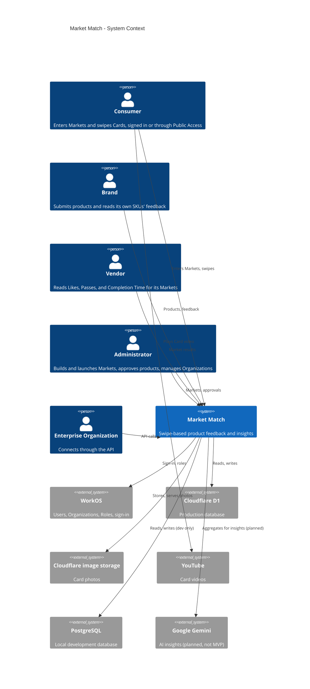
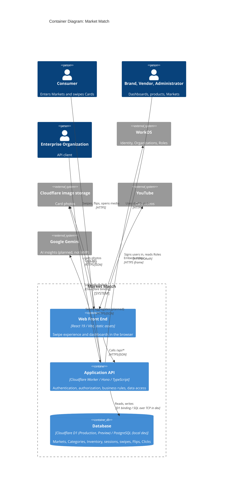

# Architectural Design

**Project:** Market Match
**Team:** Team 11
**Client:** Demetrie King, Market Match
**Version:** 0.2

---

_**How to use this template.** Instructions appear in italic square brackets. Fill in underneath them and leave them in place until the document is stable. Every section says which checkpoint it is due at. A section that is not due yet stays as it is; do not fill it with guesses to make the document look finished._

_**What this document is.** Your system's **architecture-of-record**: the one map of the whole system, every use case area, every component, every external system, and the few decisions that are expensive to change later. It is **breadth-complete and depth-shallow**. Every part of the system is named, and nothing is designed further than its responsibility. How one use case works inside its component is a design-of-record, which comes in week 7, one per use case area, and it is written against real code._

_**What it is not.** A second copy of your requirements. The specification says what the system must do and how well; this document says how the system is shaped to do it. It **cites** `UC-*`, `CO-*`, `SEC-*`, `PER-*` and the rest by identifier and never restates them. A threshold that appears here and nowhere in the specification is a requirement hiding in the wrong document._

_**The test for what belongs here.** Decide now what is hard to reverse, affects the whole system, and is forced by a quality attribute or a constraint: how many deployables, where the data lives, how users sign in, which external systems you depend on. Leave to per-area design what is local and cheap to change: class names, endpoint shapes, table columns._

_**Structure.** The sections follow **arc42** (Starke and Hruschka), with **C4** diagrams (Simon Brown) for context and containers, written as mermaid so they diff in git. All twelve arc42 sections are here in arc42's order, numbering, and titles. The three subsections whose content another document already owns (the requirements overview, the stakeholders, and the quality requirements overview) are kept as one-line links to that document, so the numbering matches arc42's and nothing is written twice. arc42 orders sections by topic, not by when you write them, so Checkpoint 1 covers sections 1–5, 8, and 9, and sections 6 and 7 come later. The full worked example is Project Pulse's [architecture-of-record](https://github.com/Washingtonwei/project-pulse/blob/main/docs/design/architectural-design.md); read it for the shape, then write your own, because your client's quality attributes are not Project Pulse's.]_

## Identifiers

_[The new identifiers this document creates. Everything else it cites keeps the identifier of the document that owns it.]_

| Space         | For                                               | Example                          |
| ------------- | ------------------------------------------------- | -------------------------------- |
| `KD-<slug>`   | Key architectural decisions                       | `KD-deployment-shape`            |
| `QS-<slug>`   | Quality scenarios                                 | `QS-cross-org-market-denied`     |
| `RISK-<slug>` | Technical risks                                   | `RISK-d1-postgres-drift`         |
| `TD-<slug>`   | Technical debt the architecture knowingly carries | `TD-swallowed-analytics-errors`  |

_[These are slugs, like every other identifier in your project, so an inserted decision renumbers nothing and a citation says what it points at. Project Pulse uses the same form: `KD-modular-monolith`, `QS-cross-team-denial`.]_

## Revision History

| Version | Date       | Author  | Change                                                                                                     |
| ------- | ---------- | ------- | ---------------------------------------------------------------------------------------------------------- |
| 0.1     | 2026-10-02 | Team 11 | Initial draft for Checkpoint 1                                                                             |
| 0.2     | 2026-10-16 | Team 11 | Checkpoint 1 feedback: quality goals, constraints, external systems, component table, 8.1, 8.2, 9.1, 9.2 |

---

## 1. Introduction and Goals

_Due: Checkpoint 1._

### 1.1 Requirements overview

_[Your [specification](../requirements/software-requirements-specification.md) and your [use cases](../requirements/use-cases.md) are the requirements overview. Link them here; do not summarize them.]_

See the [Software Requirements Specification](../requirements/software-requirements-specification.md) and the [Use Cases](../requirements/use-cases.md).

### 1.2 Quality goals

_[The **three** quality attributes that most shape your system, in priority order. Pick them from section 9 of your [specification](../requirements/software-requirements-specification.md) and cite their identifiers. If you cannot rank them, ask your client which one they would give up first; that answer is the ranking._

_These are usually the top rows of the table in section 9.1, and the two do different jobs. Here, say why each goal matters to your client. There, say which decision it forces.]_

| Priority | Quality goal                                                  | Specification handles                                                       | Why it matters to the client                                                                                                                                                                                                                             |
| -------- | ------------------------------------------------------------- | --------------------------------------------------------------------------- | -------------------------------------------------------------------------------------------------------------------------------------------------------------------------------------------------------------------------------------------------------- |
| 1        | One Organization's data never reaches another, or a wrong Role | `SEC-org-data-isolation`, `SEC-role-data-scope`, `SEC-pii-encrypted`        | Brands, colleges, and departments of one institution share one platform, and the client sets departments up as separate Organizations precisely so they cannot see each other's results (`BR-view-org-markets`). A leak ends the trust the business sells. |
| 2        | A 10,000-person QR Code event does not crash it               | `SCA-qr-event-burst`                                                        | The client's growth pitch is a large event where everyone scans one QR Code at once; "I just want to make sure that it doesn't crash" is the one performance statement he has made.                                                                       |
| 3        | Every swipe is counted once, and the client can keep it running | `ROB-swipe-exactly-once`, `MNT-client-maintainable`                         | The swipe data is the product Brands pay for, so a lost or doubled swipe is a wrong number on a Brand Dashboard. The client maintains the platform himself through Claude Code after the team leaves.                                                   |

### 1.3 Stakeholders

_[Your stakeholders are profiled in section 3.1 of [vision and scope](../requirements/vision-and-scope.md). Link it here; do not copy it.]_

See [Vision and Scope, Section 3.1 — Stakeholder Profiles](../requirements/vision-and-scope.md#31-stakeholder-profiles).

## 2. Architecture Constraints

_Due: Checkpoint 1._

_[The constraints the architecture has to honor. They are already written as `CO-*` in section 2.4 of your specification, and `OE-*` in section 2.3; **list the identifiers here, do not restate them.** Add one sentence only where a constraint narrows an architectural choice in a way that is not obvious from its text._

_Your technology stack is a constraint only if something external fixes it: the client's IT department, an existing system, or the person who maintains this after you graduate. A stack your team chose is a decision, and it goes in section 9 with the alternative you rejected.]_

- `CO-cloudflare-hosting`: this fixes the back end as Cloudflare Workers and makes Cloudflare D1, reached through a Worker binding, the production database. A long-running server process or an always-on database server is not available.
- `CO-workos-identity`: Market Match stores no credentials, and the Role and Organization records it authorizes against live in WorkOS, not in D1.
- `CO-existing-codebase`: the containers in section 5.1 are the ones the client's repository already has. This project changes what runs inside them, not how many there are.
- `CO-client-maintains`
- `CO-preview-before-production`: every environment-specific value must exist twice, once for Production and once for the Preview Link (section 8.2.6).

No `OE-*` operating-environment requirements have been confirmed yet ([OI-30](../requirements/OPEN-ISSUES.md#open)).

## 3. Context and Scope

_Due: Checkpoint 1._

_[One C4 context diagram: your system as a single box, every kind of user, and **every external system** it talks to (email, payment, an identity provider, a client database, an LLM, a file store). An external system discovered halfway through the build is a schedule risk you could have seen at the start._

_Your specification already lists the external systems. Every system named in a software interface (`SI-*`, section 8.3), a communications interface (`CI-*`, section 8.5), or a dependency (`DE-*`, section 2.5) is a box here. A box with none of those behind it is an interface your specification is missing, so add it there too._

_This is your project's one context diagram. Section 4.1 of [vision and scope](../requirements/vision-and-scope.md) holds the first draft: redraw it here in C4, then replace the drawing there with a link to this section, so there is one diagram to keep current._

_arc42 divides context into a **business context** (who and what crosses the boundary) and a **technical context** (the channels and protocols). This diagram is the business context. The protocols go on the arrows of the container diagram in section 5.1._

_The **trust boundary** is not drawn here. You name it in writing in section 8.1, as Project Pulse does.]_

**System context diagram (C4):**

| External system          | What crosses the boundary                                         | Specification                       |
| ------------------------ | ----------------------------------------------------------------- | ----------------------------------- |
| WorkOS                   | Sign-in, and each user's identity, Organization, and Role         | `SI-workos-auth`, `DE-workos`       |
| Cloudflare D1            | All production Market Match data                                  | `SI-d1-storage`, `DE-cloudflare`    |
| Cloudflare image storage | Card photos                                                       | `SI-cloudflare-images`, `DE-cloudflare` |
| YouTube                  | Card videos, loaded by the browser directly                       | `SI-youtube-video`, `DE-youtube`    |
| PostgreSQL               | The same data as D1, on a developer's machine only                | `SI-postgres-local`                 |
| Google Gemini            | Aggregated, de-identified figures out, insights back. **Planned, not in the MVP.** | `SI-gemini-insights`, `DE-gemini` |

D1 and PostgreSQL are drawn as boxes here because they are managed by others (Cloudflare) or exist only outside Production (PostgreSQL). Section 5.1 shows them as the system's database container, by environment.

## 4. Solution Strategy

_Due: Checkpoint 1._

_[Three to five bullets: the few moves that shape everything else. arc42 suggests four kinds: the technology you build on, how the system is divided at the top level, how the quality goals in section 1.2 are met, and any organizational choice that shapes the code (who maintains what, what you buy instead of build)._

_Each bullet is one sentence, and it cites what explains it: the key decision in section 9.2 where one exists, and otherwise the quality goal and the building block in section 5 it shapes. Keep it short; the reasoning lives in section 9. A bullet that cites nothing is either not load-bearing, or it is a decision you have not written down yet.]_

- **Keep the client's single Cloudflare Worker deployment** (`KD-deployment-shape`): the React front end and the Hono API ship together as one Worker per environment, over Cloudflare D1, because that is what the client can operate (`CO-client-maintains`) and Workers scale out per request for the QR Code burst (`SCA-qr-event-burst`).
- **Make the Application API the only trust boundary** (section 8.1): every Organization and Role check happens in the API, never in the browser, to meet quality goal 1 (`SEC-org-data-isolation`, `SEC-role-data-scope`).
- **Buy identity rather than build it**: WorkOS owns sign-in, Organizations, and Roles, and the Identity component (section 5.2) is the only code that talks to it (`CO-workos-identity`, `SEC-dashboard-auth`).
- **Make every feedback write idempotent**: each swipe, Flip, Click, and funnel stage carries a client-generated submission key that the Persistence component deduplicates, to meet quality goal 3 (`ROB-swipe-exactly-once`).

## 5. Building Block View

_Due: Checkpoint 1. This section is most of what your TA checks._

### 5.1 Containers

_[One C4 container diagram: the separately running or separately stored pieces inside your system box. For most projects that is a front end, a back end, and a database, and sometimes a file store. Name each container's technology. Every external system from section 3 appears again here, attached to the container that talks to it._

_Label every arrow with what it does and the protocol it uses ("Sends confirmations [SMTP]"). Those protocols are arc42's technical context._

_Under the diagram, one or two sentences on **why the system is divided this way**, citing `KD-deployment-shape`. A reader who sees three containers should not have to guess why there are not seven._

_Three containers is a normal answer. If you have more than five, check each one against section 9: which decision, driven by which quality attribute, requires it to run separately?]_

**Container diagram:**

There are three containers because the client already runs exactly these three, as one Worker serving the built front end and `/api/*` over one D1 database (`KD-deployment-shape`, `CO-existing-codebase`). Nothing in section 9.1 needs a piece that runs or scales separately: Workers already scale per request for `SCA-qr-event-burst`, and a fourth container would be one more thing the client has to deploy and keep alive (`CO-client-maintains`).

### 5.2 Use case areas and components

_[One row per use case area in your [use cases](../requirements/use-cases.md), taken from the area column of [traceability.md](../traceability.md) section 1, plus one row per **cross-cutting component** that no single area owns (authentication, notifications, file handling, an integration with an external system). A use case area with no row is a part of your system with no home; a component with no area and no cross-cutting reason is one nobody asked for._

_**Responsibility** is one sentence, what the component owns, not how it works. **Depends on** names other components and external systems, never classes. **Status** is `provisional` until the component has been built through at least one use case, and `proven` after that. At Checkpoint 1 every row is `provisional`; Checkpoint 2 turns at least one to `proven`._

_Project Pulse's component tables also name each component's package. They can because its code exists; yours does not yet, so a row here is a name and a responsibility, and packages come with the design-of-record in week 7.]_

| Use case area     | Component        | Responsibility                                                                                                                  | Depends on                                       | Status      |
| ----------------- | ---------------- | ------------------------------------------------------------------------------------------------------------------------------- | ------------------------------------------------ | ----------- |
| `MKT`             | Market Access    | Owns entry into a launched Market by Market Code or Public Access link, and the Market session that every capture belongs to    | Identity, Persistence                            | provisional |
| `PROD`            | Product Catalog  | Owns the approved Cards a Market shows, by Category, and each Card's front and back content                                     | Persistence, Media                               | provisional |
| `FDBK`            | Feedback Capture | Owns recording each impression, swipe, Flip, Click, and Engagement Funnel stage exactly once against its Market session         | Market Access, Product Catalog, Persistence      | provisional |
| `BRND`            | Brand Products   | Owns a Brand's product submissions and updates, and the Admin's Approval before they are published                              | Identity, Product Catalog, Media                 | provisional |
| _(cross-cutting)_ | Identity         | The only component that talks to WorkOS; maps a session to a user, Organization, and Role, and answers every access check      | WorkOS                                           | provisional |
| _(cross-cutting)_ | Persistence      | The only component that touches the database; owns the schema in both engines and deduplicates writes by submission key        | Cloudflare D1, PostgreSQL                        | provisional |
| _(cross-cutting)_ | Media            | Stores and serves Card photos and holds Card video links                                                                        | Cloudflare image storage, YouTube                | provisional |
| _(cross-cutting)_ | Insights         | **Planned, not in the MVP.** The only component that talks to Gemini; sends one Organization's aggregated figures, returns text | Persistence, Identity, Google Gemini             | provisional |

_[Check before Checkpoint 1: every area in your use case file appears in the first column, and every external system in section 3 appears in some Depends on cell.]_

Check: `MKT`, `PROD`, `FDBK`, and `BRND` are every area in section 3 of the use cases. WorkOS, Cloudflare D1, PostgreSQL, Cloudflare image storage, YouTube, and Google Gemini each appear in a Depends on cell.

## 6. Runtime View

_Due: Checkpoint 2. [One sequence diagram, for the use case your proving slice builds, from the user's action through every container and external system it touches. Leave this section empty until the slice exists; a sequence diagram of code nobody has written describes a guess._

_Draw it as a mermaid `sequenceDiagram`, and name the participants exactly as the containers in section 5.1 name them. If the use case calls an external system, show what happens when that system fails or does not answer; arc42 counts error scenarios among the most useful runtime views. Under the diagram, a sentence or two on anything a reader would not guess from it. Cite the use case by its `UC-*` identifier; do not restate its steps.]_

## 7. Deployment View

_Due: Checkpoint 3. [Filled in once your pipeline exists, after week 11. Three things:_

- _**Where each container runs.** Every container in section 5.1 is mapped to the host, service, or device it runs on, in each environment you have (at least development and production). A table is enough; a diagram helps once there are more than two hosts._
- _**How a change gets there.** From a merged pull request to production: what builds it, what tests it, and where it is released first._
- _**What survives a restart.** Which state is in the database or a file store, and which is lost when the application restarts._

_Section 4.4 of [vision and scope](../requirements/vision-and-scope.md) says who can operate the system and where its users are. Cite it; this section says how the deployment meets it.]_

## 8. Crosscutting Concepts

_[arc42 leaves this section an open list of concepts. This template fixes its first entry, 8.1 Security, because Checkpoint 1 asks for the trust boundary; 8.2 holds every other concept.]_

### 8.1 Security

_Due: named at Checkpoint 1, detailed at Checkpoint 2._

_[Four short paragraphs. The last three each cite the `SEC-*` requirement they answer:_

- _**Trust boundary:** the line between what you control and what you do not. Name the container that is the boundary and what sits outside it (the browser, every external system). Every request that crosses it is authenticated and authorized, and it covers every path your deployable answers, framework endpoints included. Project Pulse's Security & Compliance section shows the shape in three sentences._
- _**Authentication:** how a user proves who they are, and who issues the credential (your system, the client's sign-on, a third party)._
- _**Authorization:** the roles, and the rule for what a user may see beyond their role (a patron sees only their own orders). The second part is where most real breaches happen._
- _**Sensitive data:** what personal or regulated data the system stores, in which container, and which external systems receive any of it. How long it is kept and how it is disposed of are already in section 7.4 of your specification; cite them._

_Secrets (passwords, API keys, connection strings) never appear in this document or in the repository. Say where they will live, not what they are.]_

**Trust boundary.** The Application API, the Cloudflare Worker, is the trust boundary. The browser and everything in it (the Web Front End's code, the timings it measures, any Role or Organization it displays) sit outside it, as do WorkOS, YouTube, Cloudflare image storage, Gemini, and every Enterprise API client. Every request the Worker answers, including static asset routes and any framework or debug endpoint, is authenticated and authorized in the API before data is read. The only unauthenticated routes are Public Access Market entry and its capture (`BR-public-market`), and those can reach only the one Public Access Market they name.

**Authentication** (`SEC-dashboard-auth`). WorkOS issues every credential: a user signs in at login.marketmatch.app with a One-Time Code or a security key, and the API exchanges the result for a session. Market Match never sees or stores a password (`CO-workos-identity`). Production and the Preview Link use separate WorkOS sides, so a Preview session is never valid in Production. A Public Access Consumer is identified only by an anonymous Market session that the server generates.

**Authorization** (`SEC-org-data-isolation`, `SEC-role-data-scope`). The Roles are Consumer (every user by default), Brand, Vendor, and Admin, assigned in WorkOS only by the Admin (`BR-assign-role`, `BR-admin-role`). Beyond the Role, every query for a Market or its results is scoped by the requesting user's Organization, read from the session and never from request input. A Brand additionally sees only its own SKUs, a Vendor never receives swipe-behavior fields, and the Admin never receives an Organization's detailed data points. These scopes are applied in the API, so that the response omits forbidden fields; hiding them in the front end does not count.

**Sensitive data** (`SEC-pii-encrypted`). The personal data is users' email addresses (`BR-collect-email-only`), which live in WorkOS and are referenced from the Database, and the Demographic snapshot stored with each signed-in swipe in the Database. Both are encrypted at rest and travel only over TLS (`BR-protect-pii`). No external system other than WorkOS receives personal data. Gemini, when built, receives only aggregated, de-identified figures (`SI-gemini-insights`). Retention of Demographic snapshots is not yet decided ([OI-12](../requirements/OPEN-ISSUES.md#open)), and section 7.4 of the specification will cite the answer. Secrets (the WorkOS API key, binding names) live in Cloudflare Worker secrets for Production and the Preview Link and in an untracked `.dev.vars` locally, never in the repository.

### 8.2 Other concepts

_Due: Checkpoint 1, a subsection for every concept in the table below; then kept current, adding the file that shows each rule once code exists and a new concept whenever one appears. [Anything every component must do the same way. Your agent starts every session with no memory of the last, so a convention that is not written here gets reinvented each time. Write every concept now, while each is still cheap to choose; the last column says when a missing one would start to hurt._

_One short subsection each: the rule in one sentence, why, and the file that shows it done right once one exists. Put the one-line instruction in your charter too, citing this subsection, because the charter is what your agent always reads. Project Pulse's Crosscutting Concepts section is a worked example; its headings differ from this template's.]_

| Concept                       | The question it settles                                                                                                | When it usually bites                    |
| ----------------------------- | ---------------------------------------------------------------------------------------------------------------------- | ---------------------------------------- |
| _Error handling_              | _What does a failure look like to the caller, and where is it caught?_                                                 | _The second endpoint_                    |
| _Time and time zones_         | _Whose clock decides a deadline, what zone is stored, and can a test set the time?_                                    | _The first deadline or "submitted late"_ |
| _API conventions_             | _What shape does every response take, and how are endpoints named?_                                                    | _The second endpoint_                    |
| _Code conventions_            | _Which libraries and idioms does every file use, and which are banned? (Formatting belongs to a formatter, not here.)_ | _The first file an agent writes_         |
| _Validation_                  | _Where is input checked, and which check is the one that counts?_                                                      | _The first form_                         |
| _Configuration and secrets_   | _What differs between development and production, and where does it live?_                                             | _The first deploy_                       |
| _Logging_                     | _What is logged, at what level, and what must never be?_                                                               | _The first bug you cannot reproduce_     |
| _Persistence and concurrency_ | _Where does a transaction begin and end, and what happens when two people edit at once?_                               | _The first shared record_                |
| _Auditing_                    | _Who changed what, and when?_                                                                                          | _The first "who did this?"_              |
| _Testing_                     | _Which kinds of test, at which layer, with what data?_                                                                 | _The first pull request_                 |

#### 8.2.1 Error handling

**Rule:** every API failure returns a non-2xx status with `{ "error": { "code", "message" } }` from one Hono error handler, no route builds its own error body, and no `catch` block may swallow an error without logging it and returning a failure. **Why:** the client's repository silently drops failed analytics writes in empty `catch` blocks (`UC-FDBK-rate-product`, current state), which breaks `ROB-swipe-exactly-once`, and an exception's own message can reveal the database behind it. The front end handles every failure in one place, `services/apiService.ts`. **Shown in:** to be added with the first slice.

#### 8.2.2 Time and time zones

**Rule:** timestamps are stored in UTC as epoch milliseconds, durations (Time-to-Swipe, dwell time) are stored in milliseconds, and the server's clock stamps every stored record while the browser's clock is used only to measure a duration on one device. **Why:** Completion Time and the Engagement Funnel are derived by subtracting stored timestamps (`UC-FDBK-complete-market`), so every stage must come from one clock. Time zones matter only when a dashboard displays a date, which is converted in the browser. **Shown in:** to be added.

#### 8.2.3 API conventions

**Rule:** every endpoint lives under `/api/*` and speaks JSON over HTTPS; public, unauthenticated endpoints live under `/api/public/*` and nowhere else, and every write that can be retried accepts a submission key. **Why:** one prefix for public routes makes the sweep that verifies `SEC-dashboard-auth` mechanical, and submission keys are how `ROB-swipe-exactly-once` is met. The client's repository already uses `/api/responses` and `/api/public/responses`. **Shown in:** `worker/src/index.ts` (existing routes).

#### 8.2.4 Code conventions

**Rule:** TypeScript everywhere, with React function components in the front end and Hono routes in the Worker; access checks go through the Identity component and database access goes through the Persistence component, never inline in a route. **Why:** `CO-existing-codebase` fixes the language and frameworks, and a single place for each check is what lets the client's Claude Code sessions change one without missing the others (`MNT-client-maintainable`). **Shown in:** to be added.

#### 8.2.5 Validation

**Rule:** the API validates every input, and that check is the one that counts; front-end validation is only for the user's convenience. Enumerations are rejected when unknown, never coerced. **Why:** the browser is outside the trust boundary (section 8.1), and the client's public route today coerces unknown swipe directions to `LEFT` (`UC-FDBK-rate-product`, current state). Existing CSV product import already classifies rows as `VALID`, `WARNING`, or `ERROR`, and `ERROR` rows are not imported. **Shown in:** to be added.

#### 8.2.6 Configuration and secrets

**Rule:** every environment-specific value and secret exists separately for Production, the Preview Link, and local development: Cloudflare Worker secrets and bindings for the first two, untracked `.env.local` and `.dev.vars` locally, and a committed `.env.example` that lists every name with no values. **Why:** `CO-preview-before-production` requires two deployed environments with separate WorkOS sides, and the second client meeting showed secrets had no documented home. **Shown in:** `.env.example` (requested from the client).

#### 8.2.7 Logging

**Rule:** the Worker logs every failed write and every refused access check with the route, the error code, and the Market session or user identifier, and it never logs an email address, a Demographic answer, a token, or a request body. **Why:** a failed capture must be logged rather than silently dropped (`UC-FDBK-open-card-media` extension 2a), and `SEC-pii-encrypted` forbids plaintext personal data, which includes logs. **Shown in:** to be added.

#### 8.2.8 Persistence and concurrency

**Rule:** a swipe, its measures, and its Demographic snapshot are written in one transaction, a unique constraint on the submission key makes a retried write a no-op, and every schema change is a migration applied to both D1 and PostgreSQL in the same pull request. **Why:** `ROB-swipe-exactly-once` and `UC-FDBK-rate-product` require one stored swipe and no partial one. Most records are append-only captures, so concurrent edits matter only for Inventory and Markets, where the last Admin save wins. **Shown in:** to be added.

#### 8.2.9 Auditing

**Rule:** every Approval or rejection of a Brand's product or update records who decided, when, and on which version; captured feedback records are never updated or deleted by application code. **Why:** `BR-approve-product` makes the Admin's Approval the gate to publication, so "who approved this?" is the first audit question the client will ask. **Shown in:** to be added.

#### 8.2.10 Testing

**Rule:** every pull request carries automated tests for the behavior it changes: unit tests for derived figures (Like Rate, Completion Time), API integration tests against local PostgreSQL for every access check and every write, and the change is checked on the Preview Link before it reaches Production. **Why:** the access-check tests are the oracles of `SEC-org-data-isolation` and `SEC-role-data-scope`, and `MNT-client-maintainable` requires a test with every change. The client's existing checks for authentication, Role-based authorization, and API access are kept. **Shown in:** to be added.

## 9. Architecture Decisions

_Due: the table and one decision at Checkpoint 1; more as they are made._

### 9.1 Architecturally significant requirements

_[Not every requirement shapes the architecture. The **architecturally significant requirements** are the few that do: quality attributes and constraints where a wrong guess costs a redesign, not a bug fix. Functionality can be delivered by many structures; these are what choose among them._

_Your quality goals from section 1.2 are usually the top rows; cite them by identifier and do not explain them again. This table can also hold what is nobody's goal but still forces structure, such as a `CO-*` constraint._

_List three to six, ranked by importance to your client times difficulty to achieve. Reuse the specification's identifiers, never new ones. **At least one row is a `SEC-*` attribute.** Every system your team builds this year holds some personal data, and if no security requirement appears here, that data's protection was never designed; it will be added later, which is where security bugs come from.]_

| Rank | Requirement                                       | Specification handles                                 | Importance × difficulty | Drives                                                                                     |
| ---- | ------------------------------------------------- | ----------------------------------------------------- | ----------------------- | ------------------------------------------------------------------------------------------ |
| 1    | One Organization's data never reaches another     | `SEC-org-data-isolation`                              | High × High             | API as the only trust boundary (8.1); Identity component answers every scope check         |
| 2    | Each Role receives only its own data points       | `SEC-role-data-scope`                                 | High × Medium           | Field filtering in the API, not the front end (8.1); Identity component                     |
| 3    | 10,000-Consumer QR Code event without crashing    | `SCA-qr-event-burst`                                  | High × High             | `KD-deployment-shape` (per-request Worker scaling over D1)                                  |
| 4    | Each swipe stored exactly once                    | `ROB-swipe-exactly-once`                              | High × Medium           | Submission keys and the unique constraint (8.2.3, 8.2.8); Persistence component            |
| 5    | Personal data encrypted, sent only to WorkOS      | `SEC-pii-encrypted`, `SEC-dashboard-auth`             | High × Low              | WorkOS as identity provider (`CO-workos-identity`); Insights gets aggregates only           |
| 6    | The client can operate and change it himself      | `CO-client-maintains`, `MNT-client-maintainable`      | High × Medium           | `KD-deployment-shape`; written conventions in 8.2                                           |

### 9.2 Key decisions

_[One entry per key decision (`KD-*`), in the form below; it is what the wider industry calls an architecture decision record (ADR). Checkpoint 1 requires exactly one: **`KD-deployment-shape`**, whether your system ships as one deployable or several, and why. Every team makes this decision, and it is where over-engineering usually shows up first. Add others when you make them; do not invent them to fill the section._

_A decision without a **rejected alternative** is not a decision, it is a description. Name what you did not do and why not, so the next person does not redo the argument._

_A decision that turns out wrong is not deleted or rewritten. Mark it **Superseded by `KD-<new-slug>`** and write the new decision as its own entry, so the reasoning behind both stays readable.]_

**`KD-deployment-shape`: one Cloudflare Worker per environment.** _Accepted._

- **Driving requirements:** `CO-cloudflare-hosting`, `CO-existing-codebase`, `CO-client-maintains`, `CO-preview-before-production`, `SCA-qr-event-burst`.
- **Context:** The client already runs Market Match as two Cloudflare Workers, one for Production and one for the Preview Link. Each serves the built React front end as static assets and answers `/api/*` with a Hono API over a Cloudflare D1 database. The client deploys it himself through Claude Code and Wrangler and has no one to run additional infrastructure. His one load concern is a 10,000-person QR Code event.
- **Decision:** Ship Market Match as one deployable: a single Worker per environment containing the front end and the Application API, over one D1 database per environment. Local development runs the same Worker code against PostgreSQL. Use case areas are separated as components inside the Worker (section 5.2), not as separate services.
- **Rejected:** (a) Splitting the API into separate services per area (capture, catalog, identity), or adding a queue in front of swipe writes. Workers already scale per request, so nothing in section 9.1 requires a separate scaling unit, and each extra service is another deployment, set of secrets, and failure point the client would have to run alone. (b) Moving the API to a long-running Node.js server with a hosted PostgreSQL in production. This would make development and production identical, but it violates `CO-cloudflare-hosting` and gives the client a server to patch and keep alive.
- **Trade-off:** The front end and API are released together, so a front-end-only change redeploys the API. Production (D1) and local development (PostgreSQL) run different database engines, so a query or migration can behave differently between them; section 8.2.8 requires every migration to land in both, and the Preview Link, which runs D1, is the test that counts. If the 10,000-Consumer burst ([OI-27](../requirements/OPEN-ISSUES.md#open)) turns out to exceed D1's write capacity, this decision is revisited with a load-test result rather than a guess.

## 10. Quality Requirements

### 10.1 Quality requirements overview

_[Section 9 of your [specification](../requirements/software-requirements-specification.md) is the overview. Link it here; do not copy it.]_

See [Software Requirements Specification, Section 9 — Quality Attributes](../requirements/software-requirements-specification.md#9-quality-attributes).

### 10.2 Quality scenarios

_Due: one scenario at Checkpoint 2; one per top-ranked requirement in section 9.1 by Checkpoint 3._

_[A quality attribute says how good; a scenario says how you will know. Each one is: a **source** does a **stimulus** in an **environment**, the system gives a **response**, and a **measure** tells you it worked. The measure cites the specification's attribute for its number; it never introduces one._

_**Verified by** names the test, or the repeatable manual check, that shows the measure holds. Leave it empty until that test exists; an empty cell is an honest "not yet verified".]_

| ID                                 | Source and stimulus                                            | Environment        | Response                                | Measure                                                                                 | Verified by                                                                           |
| ---------------------------------- | -------------------------------------------------------------- | ------------------ | --------------------------------------- | --------------------------------------------------------------------------------------- | ------------------------------------------------------------------------------------- |
| _`QS-cross-employee-order-denied`_ | _A signed-on patron requests another patron's order by its ID_ | _Normal operation_ | _Refused before any order data is read_ | _Every such request is refused and returns no order fields (`SEC-employee-own-orders`)_ | _An integration test that signs in as one patron and requests another patron's order_ |

## 11. Risks and Technical Debt

_Due: Checkpoint 2, kept current after._

_[**Technical** risks and debt only. Business risks are `RI-*` in [vision and scope](../requirements/vision-and-scope.md); do not copy them here. Project risks, such as a teammate dropping the course, belong in neither document. Seed this list from the technical `RI-*` items and from any [OPEN-ISSUES.md](../requirements/OPEN-ISSUES.md) entry whose answer could change the architecture._

_A **risk** might happen: an external system you have never called, a client dataset you have never seen. **Debt** has already happened: a shortcut you took on purpose and intend to pay back. Each row says how you would find out, or how you would fix it._

_A risk written as a category ("security", "performance") is not a risk. Write the mechanism: what fails, and what that breaks.]_

| ID                               | Type   | What could go wrong, and what it breaks                                                                                                   | Mitigation or fix                                                                                     | Cites                              |
| -------------------------------- | ------ | ----------------------------------------------------------------------------------------------------------------------------------------- | ----------------------------------------------------------------------------------------------------- | ---------------------------------- |
| _`RISK-payroll-api-unavailable`_ | _Risk_ | _Nobody has seen the Payroll System's interface. If it only accepts a nightly batch file, ordering cannot confirm payment at order time._ | _Ask for the interface document at the next client meeting; build Payment against a stub until then._ | _`DE-payroll-integration`, `OI-4`_ |

## 12. Glossary

_[Domain terms live in your [project glossary](../requirements/project-glossary.md). Link it and add nothing here unless you need an architecture term your team uses in a special sense.]_

See the [project glossary](../requirements/project-glossary.md).

---

## Working this document with your agent

_[Delegate: drawing the C4 diagrams in mermaid from your use case list and your specification's interfaces; checking that every use case area has a component and every external system has a component that depends on it; checking that every identifier this document cites exists in the document that owns it; drafting the rejected alternative for a decision you have already made._

_Keep human: the ranking in section 9.1 and every `KD-*`. The decisions are the part of this document your client and the team that inherits this system will hold you to, and they depend on facts about your client that are not in any file._

_**The specific failure to watch for: over-engineering.** Ask an agent for an architecture and it will propose the one it has seen most often in writing, which is built for a company a thousand times your size: microservices, a message queue, Kubernetes, a cache in front of a database that holds ten thousand rows. Every one of those is a real answer to a problem you do not have, and each one adds something that can break at 2 a.m. with nobody to fix it. For every container and every decision the agent proposes, ask which requirement in section 9.1 forces it. If the answer is none, cut it.]_
