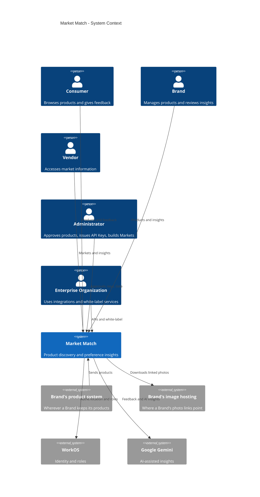
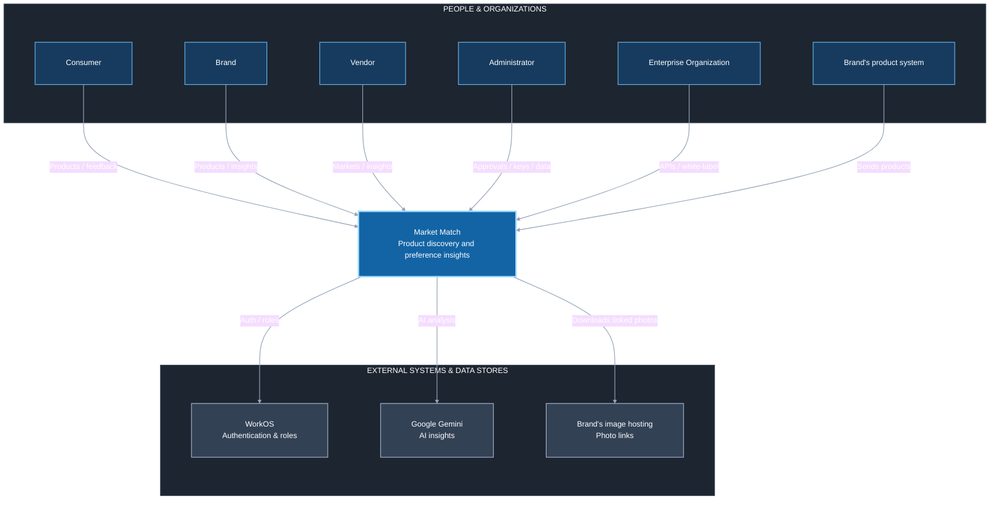
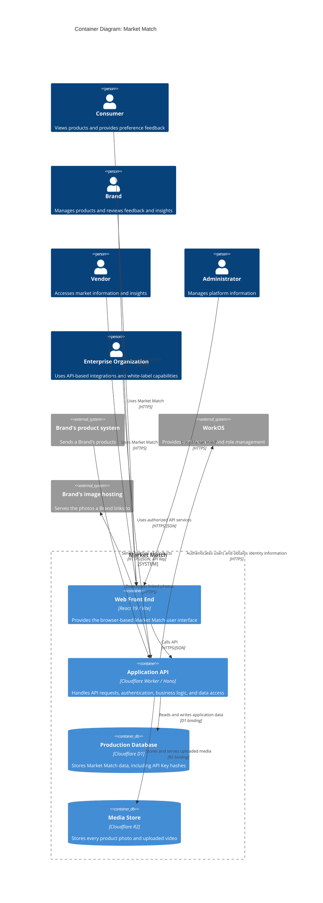

# Architectural Design

**Project:** Market Match
**Team:** Team 11
**Client:** Demetrie King, Market Match
**Version:** 0.2

---

_**How to use this template.** Instructions appear in italic square brackets. Fill in underneath them and leave them in place until the document is stable. Every section says which checkpoint it is due at. A section that is not due yet stays as it is; do not fill it with guesses to make the document look finished._

_**What this document is.** Your system's **architecture-of-record**: the one map of the whole system, every use case area, every component, every external system, and the few decisions that are expensive to change later. It is **breadth-complete and depth-shallow**. Every part of the system is named, and nothing is designed further than its responsibility. How one use case works inside its component is a design-of-record, which comes in week 7, one per use case area, and it is written against real code._

_**What it is not.** A second copy of your requirements. The specification says what the system must do and how well; this document says how the system is shaped to do it. It **cites** `UC-*`, `CO-*`, `SEC-*`, `PER-*` and the rest by identifier and never restates them. A threshold that appears here and nowhere in the specification is a requirement hiding in the wrong document._

_**The test for what belongs here.** Decide now what is hard to reverse, affects the whole system, and is forced by a quality attribute or a constraint: how many deployables, where the data lives, how users sign in, which external systems you depend on. Leave to per-area design what is local and cheap to change: class names, endpoint shapes, table columns._

_**Structure.** The sections follow **arc42** (Starke and Hruschka), with **C4** diagrams (Simon Brown) for context and containers, written as mermaid so they diff in git. All twelve arc42 sections are here in arc42's order, numbering, and titles. The three subsections whose content another document already owns (the requirements overview, the stakeholders, and the quality requirements overview) are kept as one-line links to that document, so the numbering matches arc42's and nothing is written twice. arc42 orders sections by topic, not by when you write them, so Checkpoint 1 covers sections 1–5, 8, and 9, and sections 6 and 7 come later. The full worked example is Project Pulse's [architecture-of-record](https://github.com/Washingtonwei/project-pulse/blob/main/docs/design/architectural-design.md); read it for the shape, then write your own, because your client's quality attributes are not Project Pulse's.]_

## Identifiers

_[The new identifiers this document creates. Everything else it cites keeps the identifier of the document that owns it.]_

| Space         | For                                               | Example                          |
| ------------- | ------------------------------------------------- | -------------------------------- |
| `KD-<slug>`   | Key architectural decisions                       | `KD-single-deployable`           |
| `QS-<slug>`   | Quality scenarios                                 | `QS-cross-employee-order-denied` |
| `RISK-<slug>` | Technical risks                                   | `RISK-payroll-api-unavailable`   |
| `TD-<slug>`   | Technical debt the architecture knowingly carries | `TD-no-rate-limiting`            |

_[These are slugs, like every other identifier in your project, so an inserted decision renumbers nothing and a citation says what it points at. Project Pulse uses the same form: `KD-modular-monolith`, `QS-cross-team-denial`.]_

## Revision History

| Version | Date | Author | Change                         |
| ------- | ---- | ------ | ------------------------------ |
| 0.1     |   2026-10-02    |   Team 11     | Initial draft for Checkpoint 1 |
| 0.2     | 2026-10-28 | Matthew Stafford | Brand product import (BRND): quality goals and the §9.1 ranking for BRND; the Brand's product system and the R2 Media Store in the context and container diagrams, and PostgreSQL removed; the §5.2 component table; API Keys in §8.1; §8.2.5, §8.2.7, §8.2.8, §8.2.9, and §8.2.10 rewritten to match the code; `KD-api-key-storage`, `KD-import-in-request`, and `KD-photos-copied`; §11 risks and debt |

---

## 1. Introduction and Goals

_Due: Checkpoint 1._

### 1.1 Requirements overview

_[Your [specification](../requirements/software-requirements-specification.md) and your [use cases](../requirements/use-cases.md) are the requirements overview. Link them here; do not summarize them.]_

See the [Software Requirements Specification](../requirements/software-requirements-specification.md) and the [Use Cases](../requirements/use-cases.md).

### 1.2 Quality goals

_[The **three** quality attributes that most shape your system, in priority order. Pick them from section 9 of your [specification](../requirements/software-requirements-specification.md) and cite their identifiers. If you cannot rank them, ask your client which one they would give up first; that answer is the ranking._

_These are usually the top rows of the table in section 9.1, and the two do different jobs. Here, say why each goal matters to your client. There, say which decision it forces._

_Example, from the Cafeteria Ordering System:]_

| Priority | Quality goal                              | Specification handles                            | Why it shapes the architecture                                                                                                      |
| -------- | ----------------------------------------- | ------------------------------------------------ | ----------------------------------------------------------------------------------------------------------------------------------- |
| 1 | One Brand never reads or changes another Brand's products | `SEC-brand-isolation` | Brands are competing companies, and from phase 1 a Brand's own system writes into Market Match with no person signed in. Every product read and write is scoped by a Brand taken from the session or the API Key, never from the request. |
| 2 | An API Key reaches one Brand and can be ended at once | `SEC-api-key-strength`, `SEC-api-key-ending` | The product API is Market Match's first entry point with no signed-in person; a leaked key would let anyone fill a Brand's catalog. Keys are hashed, belong to one Brand, and are checked on every request (`KD-api-key-storage`). |
| 3 | A sending stopped partway can be sent again without duplicates | `ROB-import-resend` | A Brand's system retries when a sending fails. Matching every product by its SKU within the Brand makes any sending safe to repeat, which is what lets a sending run in one request (`KD-import-in-request`). |

Ranked by Matthew Stafford on 2026-10-28 from the BRND requirements, the only area whose quality attributes are in the specification so far. The owners of MKT, PROD, and FDBK re-rank this table when their attributes are added.

### 1.3 Stakeholders

_[Your stakeholders are profiled in section 3.1 of [vision and scope](../requirements/vision-and-scope.md). Link it here; do not copy it.]_

See [Vision and Scope, Section 3.1 — Stakeholder Profiles](../requirements/vision-and-scope.md#31-stakeholder-profiles).

## 2. Architecture Constraints

_Due: Checkpoint 1._

_[The constraints the architecture has to honor. They are already written as `CO-*` in section 2.4 of your specification, and `OE-*` in section 2.3; **list the identifiers here, do not restate them.** Add one sentence only where a constraint narrows an architectural choice in a way that is not obvious from its text._

_Your technology stack is a constraint only if something external fixes it: the client's IT department, an existing system, or the person who maintains this after you graduate. A stack your team chose is a decision, and it goes in section 9 with the alternative you rejected.]_

## 3. Context and Scope

_Due: Checkpoint 1._

_[One C4 context diagram: your system as a single box, every kind of user, and **every external system** it talks to (email, payment, an identity provider, a client database, an LLM, a file store). An external system discovered halfway through the build is a schedule risk you could have seen at the start._

_Your specification already lists the external systems. Every system named in a software interface (`SI-*`, section 8.3), a communications interface (`CI-*`, section 8.5), or a dependency (`DE-*`, section 2.5) is a box here. A box with none of those behind it is an interface your specification is missing, so add it there too._

_This is your project's one context diagram. Section 4.1 of [vision and scope](../requirements/vision-and-scope.md) holds the first draft: redraw it here in C4, then replace the drawing there with a link to this section, so there is one diagram to keep current._

_arc42 divides context into a **business context** (who and what crosses the boundary) and a **technical context** (the channels and protocols). This diagram is the business context. The protocols go on the arrows of the container diagram in section 5.1._

_The **trust boundary** is not drawn here. You name it in writing in section 8.1, as Project Pulse does._
**System context diagram (C4):**

The following is the authoritative system-context view. Relationship labels are intentionally short to reduce visual overlap in Mermaid's C4 renderer.

**Readable presentation view (same context, spacious layout):**

**External interactions:** WorkOS supplies authentication and role management. A Brand's product system sends products through Market Match's API with the API Key the Admin gave the Brand (`SI-brand-product-system`). Photo links in a sending point at the Brand's own image hosting; Market Match downloads each photo once, checks it, and keeps its own copy (`KD-photos-copied`). Google Gemini is shown for the proposed AI-assisted feedback analysis; the Worker declares a `GEMINI_API_KEY` but calls nothing with it, so its status is to be confirmed. Cloudflare D1 and R2 are Market Match's own storage, so they are containers in section 5.1, not external systems; local development uses a local D1 database, never PostgreSQL.

## 4. Solution Strategy

_Due: Checkpoint 1._

_[Three to five bullets: the few moves that shape everything else. arc42 suggests four kinds: the technology you build on, how the system is divided at the top level, how the quality goals in section 1.2 are met, and any organizational choice that shapes the code (who maintains what, what you buy instead of build)._

_Each bullet is one sentence, and it cites what explains it: the key decision in section 9.2 where one exists, and otherwise the quality goal and the building block in section 5 it shapes. Keep it short; the reasoning lives in section 9. A bullet that cites nothing is either not load-bearing, or it is a decision you have not written down yet._

- **Preserve the existing Market Match production deployment shape** (`KD-deployment-shape`): the React front end and Cloudflare Worker API are deployed together, with Cloudflare D1 providing production data storage.
- **Separate the browser interface, application API, and persistent data into three architectural containers** (section 5.1), keeping user interaction, server-side application behavior, and production data storage separated by responsibility.
- **Use WorkOS as the external authentication service** (sections 3 and 5.1), with authentication handled through the application API rather than implementing a separate authentication system within Market Match.
- **Authenticate a Brand's own system with an API Key that Market Match issues and checks itself** (`KD-api-key-storage`), so every product request has exactly one Brand from the session or the key (quality goals 1 and 2).
- **Route every product submission, by hand, by spreadsheet, or through the API, through one Catalog component that checks, stores, and holds it for Approval** (section 5.2; `FR-PROD-server-checks`), handling each sending in one request (`KD-import-in-request`).

## 5. Building Block View

_Due: Checkpoint 1. This section is most of what your TA checks._

### 5.1 Containers

_[One C4 container diagram: the separately running or separately stored pieces inside your system box. For most projects that is a front end, a back end, and a database, and sometimes a file store. Name each container's technology. Every external system from section 3 appears again here, attached to the container that talks to it._

_Label every arrow with what it does and the protocol it uses ("Sends confirmations [SMTP]"). Those protocols are arc42's technical context._

_Under the diagram, one or two sentences on **why the system is divided this way**, citing `KD-deployment-shape`. A reader who sees three containers should not have to guess why there are not seven._

_Three containers is a normal answer. If you have more than five, check each one against section 9: which decision, driven by which quality attribute, requires it to run separately?_

**Container diagram:**

The system uses a browser-based React front end, a Cloudflare Worker API, Cloudflare D1 for data, and Cloudflare R2 for uploaded media, all on the client's existing Cloudflare deployment (`KD-deployment-shape`). R2 is separate from D1 because a database is the wrong place for multi-megabyte files; the client's app already stores uploads there, and imported photos are copied there too (`KD-photos-copied`). A Brand's product system calls the same Application API as the browser, so there is one place that enforces Brand isolation (quality goal 1), not a second service for integrations.

### 5.2 Use case areas and components

_[One row per use case area in your [use cases](../requirements/use-cases.md), taken from the area column of [traceability.md](../traceability.md) section 1, plus one row per **cross-cutting component** that no single area owns (authentication, notifications, file handling, an integration with an external system). A use case area with no row is a part of your system with no home; a component with no area and no cross-cutting reason is one nobody asked for._

_**Responsibility** is one sentence, what the component owns, not how it works. **Depends on** names other components and external systems, never classes. **Status** is `provisional` until the component has been built through at least one use case, and `proven` after that. At Checkpoint 1 every row is `provisional`; Checkpoint 2 turns at least one to `proven`._

_Project Pulse's component tables also name each component's package. They can because its code exists; yours does not yet, so a row here is a name and a responsibility, and packages come with the design-of-record in week 7._

_Example:]_

| Use case area | Component | Responsibility | Depends on | Status |
| --- | --- | --- | --- | --- |
| `MKT` | Markets | Owns entering a Market by its Market Code and which Markets a Consumer may enter | Identity, Catalog | provisional |
| `PROD` | Product Details | Shows a Consumer an approved product's Card and the details on its back | Catalog, Media | provisional |
| `FDBK` | Feedback | Records swipes, Flips, Clicks, and Market completion, and reports them to each role | Markets, Catalog, Identity | provisional |
| `BRND` | Catalog | Owns each Brand's Inventory, Categories, product submissions from all three routes, their checks, Approval, and removal | Identity, Media, Brand's image hosting | provisional |
| (cross-cutting) | Identity | Turns a WorkOS session or an API Key into one user, role, and Brand for every request, and issues and ends API Keys | WorkOS | provisional |
| (cross-cutting) | Media | The only component that writes to or serves from the Media Store | (Media Store) | provisional |

The MKT, PROD, and FDBK rows name each area's component from its use case list; their owners refine them with their designs-of-record. Google Gemini has no component because nothing calls it yet (section 3).

_[Check before Checkpoint 1: every area in your use case file appears in the first column, and every external system in section 3 appears in some Depends on cell.]_

## 6. Runtime View

_Due: Checkpoint 2. [One sequence diagram, for the use case your proving slice builds, from the user's action through every container and external system it touches. Leave this section empty until the slice exists; a sequence diagram of code nobody has written describes a guess._

_Draw it as a mermaid `sequenceDiagram`, and name the participants exactly as the containers in section 5.1 name them. If the use case calls an external system, show what happens when that system fails or does not answer; arc42 counts error scenarios among the most useful runtime views. Under the diagram, a sentence or two on anything a reader would not guess from it. Cite the use case by its `UC-*` identifier; do not restate its steps.]_

## 7. Deployment View

_Due: Checkpoint 3. [Filled in once your pipeline exists, after week 11. Three things:_

- _**Where each container runs.** Every container in section 5.1 is mapped to the host, service, or device it runs on, in each environment you have (at least development and production). A table is enough; a diagram helps once there are more than two hosts._
- _**How a change gets there.** From a merged pull request to production: what builds it, what tests it, and where it is released first._
- _**What survives a restart.** Which state is in the database or a file store, and which is lost when the application restarts._

_Section 4.4 of [vision and scope](../requirements/vision-and-scope.md) says who can operate the system and where its users are. Cite it; this section says how the deployment meets it.]_

## 8. Crosscutting Concepts

_[arc42 leaves this section an open list of concepts. This template fixes its first entry, 8.1 Security, because Checkpoint 1 asks for the trust boundary; 8.2 holds every other concept.]_

### 8.1 Security

_Due: named at Checkpoint 1, detailed at Checkpoint 2._

_[Four short paragraphs. The last three each cite the `SEC-*` requirement they answer:_

- _**Trust boundary:** the line between what you control and what you do not. Name the container that is the boundary and what sits outside it (the browser, every external system). Every request that crosses it is authenticated and authorized, and it covers every path your deployable answers, framework endpoints included. Project Pulse's Security & Compliance section shows the shape in three sentences._
- _**Authentication:** how a user proves who they are, and who issues the credential (your system, the client's sign-on, a third party)._
- _**Authorization:** the roles, and the rule for what a user may see beyond their role (a patron sees only their own orders). The second part is where most real breaches happen._
- _**Sensitive data:** what personal or regulated data the system stores, in which container, and which external systems receive any of it. How long it is kept and how it is disposed of are already in section 7.4 of your specification; cite them._

_Secrets (passwords, API keys, connection strings) never appear in this document or in the repository. Say where they will live, not what they are.]_

**Trust boundary:** The Application API running in the Cloudflare Worker is the server-side trust boundary for Market Match. Outside it sit the browser, a Brand's product system, the Brand's image hosting, and WorkOS. Every request that crosses it is authenticated and authorized by the Application API before any protected data is read, on every `/api/*` path, including the media and image routes.

**Authentication:** People sign in through WorkOS, and the Application API keeps their session in the `mm_session` cookie. A Brand's product system has no person behind it: it sends the API Key the Admin generated for that Brand, which the Application API checks against a hash in D1 (`KD-api-key-storage`). A request carrying neither is refused (`SEC-authentication`); a replaced or revoked key, or one whose Brand lost access, is refused from the moment it ends (`SEC-api-key-ending`). Keys carry at least 256 bits of randomness and are shown once (`SEC-api-key-strength`).

**Authorization:** Roles are Admin, Brand, Vendor, and Consumer, assigned in WorkOS. Beyond the role, a Brand acts only on its own Inventory and Categories: the Brand is taken from the session's Organization or from the API Key, never from the request body, and every product query filters by it (`SEC-brand-isolation`). Only the Admin approves products and generates or revokes API Keys.

**Sensitive data:** D1 holds Consumers' emails and the demographic answers stored with each swipe (whether it may hold the latter is `OI-45`; `SEC-pii-protection`), and API Key hashes, never the keys. Retention and disposal are not yet written in section 7.4 of the specification. API Keys and WorkOS credentials are never logged. Secrets live in `.env.local` and `.dev.vars` locally and as Cloudflare Worker secrets in production.

### 8.2 Other concepts

_Due: Checkpoint 1, a subsection for every concept in the table below; then kept current, adding the file that shows each rule once code exists and a new concept whenever one appears. [Anything every component must do the same way. Your agent starts every session with no memory of the last, so a convention that is not written here gets reinvented each time. Write every concept now, while each is still cheap to choose; the last column says when a missing one would start to hurt._

_One short subsection each: the rule in one sentence, why, and the file that shows it done right once one exists. Put the one-line instruction in your charter too, citing this subsection, because the charter is what your agent always reads. Project Pulse's Crosscutting Concepts section is a worked example; its headings differ from this template's.]_

| Concept                       | The question it settles                                                                                                | When it usually bites                    |
| ----------------------------- | ---------------------------------------------------------------------------------------------------------------------- | ---------------------------------------- |
| _Error handling_              | _What does a failure look like to the caller, and where is it caught?_                                                 | _The second endpoint_                    |
| _Time and time zones_         | _Whose clock decides a deadline, what zone is stored, and can a test set the time?_                                    | _The first deadline or "submitted late"_ |
| _API conventions_             | _What shape does every response take, and how are endpoints named?_                                                    | _The second endpoint_                    |
| _Code conventions_            | _Which libraries and idioms does every file use, and which are banned? (Formatting belongs to a formatter, not here.)_ | _The first file an agent writes_         |
| _Validation_                  | _Where is input checked, and which check is the one that counts?_                                                      | _The first form_                         |
| _Configuration and secrets_   | _What differs between development and production, and where does it live?_                                             | _The first deploy_                       |
| _Logging_                     | _What is logged, at what level, and what must never be?_                                                               | _The first bug you cannot reproduce_     |
| _Persistence and concurrency_ | _Where does a transaction begin and end, and what happens when two people edit at once?_                               | _The first shared record_                |
| _Auditing_                    | _Who changed what, and when?_                                                                                          | _The first "who did this?"_              |
| _Testing_                     | _Which kinds of test, at which layer, with what data?_                                                                 | _The first pull request_                 |

_Example, from the Cafeteria Ordering System:_

**8.2.1 Error handling.** _Every endpoint returns `{ "ok": false, "error": { "code", "message" } }` on failure, produced by one exception handler; no controller builds its own error body, and no response carries an exception's own message. Why: the ordering screen and the menu screen share one error display, and an exception's message can reveal the database behind it. Shown in: `ApiExceptionHandler`._

#### 8.2.1 Error handling

Frontend API calls are centralized through `services/apiService.ts`; non-successful HTTP responses are treated as errors using the error information returned by the API. This keeps API failure handling consistent across frontend features.

#### 8.2.2 Time and time zones

No project-wide time-zone convention is documented in the existing Market Match architecture. This remains to be defined if requirements introduce deadlines or other time-sensitive behavior.

#### 8.2.3 API conventions

Frontend-to-backend communication uses `/api/*` endpoints with JSON over HTTPS. Frontend API access is centralized through `services/apiService.ts`.

#### 8.2.4 Code conventions

No architecture-level project-wide code convention beyond the existing technology and repository structure is currently documented. Existing conventions should be preserved unless the team records a new decision.

#### 8.2.5 Validation

Every check that decides whether data is stored runs in the Application API, once, in one function per kind of data, and every route that stores that data calls it: a product is checked the same way whether it was entered by hand, imported by spreadsheet, or sent through the API (`FR-PROD-server-checks`). Checks in the browser are a convenience for the user and never the one that counts. Why: today `POST /api/products/bulk` stores whatever it receives, because its only checks run in the Brand's browser, and the Admin's CSV upload skips them. Shown in: not yet; the Catalog's product check is the first, in `UC-BRND-create-product`.

#### 8.2.6 Configuration and secrets

Environment-specific configuration and secrets are kept outside source code. Local development uses environment files such as `.env.local` and `.dev.vars`, while production Worker secrets are managed through Cloudflare; secrets must not be committed to the repository.

#### 8.2.7 Logging

Log identifiers, never content: no secrets, session tokens, API Keys, or passwords, and for a person their ID, never their email or demographic answers; never log a whole object. Every `catch` that does not rethrow logs the exception, and no `catch` is empty. Why: Worker logs are readable by anyone with access to the Cloudflare account, and the Feedback data is personal. The same rule is in `AGENTS.md`.

#### 8.2.8 Persistence and concurrency

Cloudflare D1 is the only database: production and preview use their own D1 databases, and local development (`npm run dev`) uses a local D1 database, never PostgreSQL. Schema changes are Drizzle migrations in `worker/migrations/`, never renamed, because D1 records applied migrations by filename; new ones continue from `0008`. A change that writes several rows (a sending, approving many products at once) commits each product's rows together, so a product is never half-stored; a sending stopped partway is completed by sending it again, matched by SKU (`ROB-import-resend`). When two people act on one record, the later action is checked against the version it was based on and refused if that version changed (`UC-BRND-approve-product` extension 6a).

#### 8.2.9 Auditing

Every change to a product's Approval, an API Key's status, or a product's removal records who made it (a user ID, or the API Key's ID for a sending) and when, in D1, and the record is never edited. Why: the BRND use cases require it (their POST conditions), and a refused sending with an ended key is recorded so the Admin can see it (`UC-BRND-send-products` extension 2a).

#### 8.2.10 Testing

`MM-Version` has no test framework, no tests, and no linter. Adding one is a new dependency, which a person decides first (`AGENTS.md`). Until then, each design-of-record lists its tests, one per main flow and extension, and they are run by hand against `npm run dev` and recorded in the pull request. The first framework added is a decision recorded in section 9.2.

## 9. Architecture Decisions

_Due: the table and one decision at Checkpoint 1; more as they are made._

### 9.1 Architecturally significant requirements

_[Not every requirement shapes the architecture. The **architecturally significant requirements** are the few that do: quality attributes and constraints where a wrong guess costs a redesign, not a bug fix. Functionality can be delivered by many structures; these are what choose among them._

_Your quality goals from section 1.2 are usually the top rows; cite them by identifier and do not explain them again. This table can also hold what is nobody's goal but still forces structure, such as a `CO-*` constraint._

_List three to six, ranked by importance to your client times difficulty to achieve. Reuse the specification's identifiers, never new ones. **At least one row is a `SEC-*` attribute.** Every system your team builds this year holds some personal data, and if no security requirement appears here, that data's protection was never designed; it will be added later, which is where security bugs come from.]_

| Rank | Requirement | Specification handles | Importance × difficulty | Drives |
| --- | --- | --- | --- | --- |
| 1 | One Brand never reads or changes another Brand's products | `SEC-brand-isolation` | High × Medium | Identity resolves one Brand per request; the Catalog filters every query by it (section 8.1) |
| 2 | API Keys are strong, shown once, and end at once | `SEC-api-key-strength`, `SEC-api-key-ending` | High × Medium | `KD-api-key-storage` |
| 3 | A stopped sending can be resent without duplicates | `ROB-import-resend` | High × Low | `KD-import-in-request` |
| 4 | Every product's result within 60 seconds for a 200-product sending | `PER-import-results` | Medium × Medium | `KD-import-in-request`, `KD-photos-copied` |
| 5 | At most 200 products per sending | `SCA-import-batch-limit` | Medium × Low | `KD-import-in-request` |

Ranked by Matthew Stafford, 2026-10-28, for the BRND area; see section 1.2.

### 9.2 Key decisions

_[One entry per key decision (`KD-*`), in the form below; it is what the wider industry calls an architecture decision record (ADR). Checkpoint 1 requires exactly one: **`KD-deployment-shape`**, whether your system ships as one deployable or several, and why. Every team makes this decision, and it is where over-engineering usually shows up first. Add others when you make them; do not invent them to fill the section._

_A decision without a **rejected alternative** is not a decision, it is a description. Name what you did not do and why not, so the next person does not redo the argument._

_A decision that turns out wrong is not deleted or rewritten. Mark it **Superseded by `KD-<new-slug>`** and write the new decision as its own entry, so the reasoning behind both stays readable._

**`KD-deployment-shape`: one application deployment.** _Accepted._

- **Driving requirements:** Existing Market Match production architecture and deployment environment.
- **Context:** Market Match already has a production deployment in which the React frontend is built as static assets, `/api/*` requests are handled by a Cloudflare Worker, and production data is stored in Cloudflare D1.
- **Decision:** Continue the existing production deployment shape: deploy the built React frontend and the API together through the Cloudflare Worker deployment, with Cloudflare D1 as the production database.
- **Rejected:** Split the frontend and API into independently deployed services. This would change the existing production deployment model and introduce additional deployment and integration complexity without a documented requirement for that separation.
- **Trade-off:** The frontend and API remain coupled at deployment time. Local development runs the same Worker against a local D1 database, so it matches production's engine.

**`KD-api-key-storage`: API Keys are Market Match's own, stored as hashes in D1.** _Accepted, 2026-10-28, Matthew Stafford._

- **Driving requirements:** `SEC-api-key-strength`, `SEC-api-key-ending`, `SEC-brand-isolation`; `UC-BRND-generate-api-key`, `UC-BRND-send-products`; `BR-admin-issues-api-key`.
- **Context:** The client gives each Brand its key himself (fifth client meeting). Each Brand is already a WorkOS Organization, and WorkOS offers organization-owned API keys with a validation endpoint.
- **Decision:** The Application API generates each key from a cryptographic random source, shows it once to the Admin, and stores only its SHA-256 hash in a D1 table with its Brand, status, and who generated or ended it and when. A sending is authenticated by hashing the key it carries and looking it up; an ended key is a status change, effective on the next request.
- **Rejected:** WorkOS API Keys. They would give a hosted management widget and revocation, but every sending would wait on a call to WorkOS, local development would need WorkOS for the API too, and it is a WorkOS feature the client has not used, with pricing we have not seen. A plain hash suffices because a 256-bit random key cannot be guessed, so a slow password hash adds nothing.
- **Trade-off:** The team writes and maintains key generation, revocation, and the Admin's screen for them.

**`KD-import-in-request`: a sending is checked and stored in the one request that delivers it.** _Accepted, 2026-10-28, Matthew Stafford._

- **Driving requirements:** `PER-import-results` (60 seconds), `SCA-import-batch-limit` (200), `ROB-import-resend`.
- **Context:** A sending carries at most 200 products and the Brand's system waits for every result. Matching by SKU makes a repeated sending harmless.
- **Decision:** The Application API checks every product of a sending, stores the valid ones waiting for Approval, and returns every result in the same request. Spreadsheet imports and API sendings share this path.
- **Rejected:** Background processing with Cloudflare Queues and a results endpoint the Brand's system polls. It would allow larger or slower sendings, but adds a platform service on the client's account and a second way for a sending to fail, which neither the 60-second limit nor the 200-product limit requires.
- **Trade-off:** One request does all the work, so it is bounded by the Worker's limits per request: on the Workers Free plan, 50 outbound calls, which is fewer than the photo checks of a 200-product sending (`RISK-workers-plan-limits`, `OI-59`). If the limits or the client's numbers rule it out, this decision is superseded, not edited.

**`KD-photos-copied`: Market Match keeps its own copy of every imported photo.** _Accepted, 2026-10-28, Matthew Stafford._

- **Driving requirements:** `BR-photo-size`, `BR-approve-product`, `PER-import-results`; `RI-broken-product-photos` in vision and scope.
- **Context:** Photos uploaded through Market Match already go to the Media Store, and the client stores every photo in the app himself today, from the Brand's Google Drive (fifth client meeting). Photos in a spreadsheet or an API sending arrive as links to the Brand's own hosting. Checking a linked photo's format and size already means downloading it, so keeping the download costs one more write.
- **Decision:** When a product is stored, Market Match downloads each linked photo once, checks that it is JPEG or PNG and under 3 MB, and stores it in the Media Store through the Media component; the product then points only at the stored copy. The Brand's link is kept as the photo's source. A photo that cannot be downloaded or fails a check fails its product (`UC-BRND-import-products` extension 4c, `UC-BRND-send-products` extension 3c).
- **Rejected:** Keeping the Brand's links, as `POST /api/products/bulk` does today. It stores nothing, but a Card breaks when the Brand moves or deletes the image, and can show a different picture than the one the Admin approved, which defeats `BR-approve-product`. It does not avoid the Workers plan question either, because checking each photo already takes one download.
- **Trade-off:** The client's R2 storage grows, at most about 1.8 GB per 200 products with three photos under 3 MB each, and a sending makes two calls per photo (download and store), up to 1,200 for 200 products, which needs the Workers Paid plan (`RISK-workers-plan-limits`, `OI-59`).

## 10. Quality Requirements

### 10.1 Quality requirements overview

_[Section 9 of your [specification](../requirements/software-requirements-specification.md) is the overview. Link it here; do not copy it.]_

### 10.2 Quality scenarios

_Due: one scenario at Checkpoint 2; one per top-ranked requirement in section 9.1 by Checkpoint 3._

_[A quality attribute says how good; a scenario says how you will know. Each one is: a **source** does a **stimulus** in an **environment**, the system gives a **response**, and a **measure** tells you it worked. The measure cites the specification's attribute for its number; it never introduces one._

_**Verified by** names the test, or the repeatable manual check, that shows the measure holds. Leave it empty until that test exists; an empty cell is an honest "not yet verified".]_

| ID                                 | Source and stimulus                                            | Environment        | Response                                | Measure                                                                                 | Verified by                                                                           |
| ---------------------------------- | -------------------------------------------------------------- | ------------------ | --------------------------------------- | --------------------------------------------------------------------------------------- | ------------------------------------------------------------------------------------- |
| _`QS-cross-employee-order-denied`_ | _A signed-on patron requests another patron's order by its ID_ | _Normal operation_ | _Refused before any order data is read_ | _Every such request is refused and returns no order fields (`SEC-employee-own-orders`)_ | _An integration test that signs in as one patron and requests another patron's order_ |

## 11. Risks and Technical Debt

_Due: Checkpoint 2, kept current after._

_[**Technical** risks and debt only. Business risks are `RI-*` in [vision and scope](../requirements/vision-and-scope.md); do not copy them here. Project risks, such as a teammate dropping the course, belong in neither document. Seed this list from the technical `RI-*` items and from any [OPEN-ISSUES.md](../requirements/OPEN-ISSUES.md) entry whose answer could change the architecture._

_A **risk** might happen: an external system you have never called, a client dataset you have never seen. **Debt** has already happened: a shortcut you took on purpose and intend to pay back. Each row says how you would find out, or how you would fix it._

_A risk written as a category ("security", "performance") is not a risk. Write the mechanism: what fails, and what that breaks.]_

| ID | Type | What could go wrong, and what it breaks | Mitigation or fix | Cites |
| --- | --- | --- | --- | --- |
| `RISK-workers-plan-limits` | Risk | If the client's account is on the Workers Free plan, one request may make only 50 calls to other services, and copying the photos of a 200-product sending takes up to 1,200 (a download and a store per photo), so a full sending cannot be processed in one request. | Check the plan with the team's read-only Cloudflare access; if it is Free, the client decides whether to move to Paid (`OI-59`). Until then, lower the batch limit or supersede `KD-import-in-request`. | `KD-import-in-request`, `KD-photos-copied`, `OI-59` |
| `RISK-photo-fetch-abuse` | Risk | Fetching a link a Brand supplies lets an outsider make the Worker request any address, including very large files. The existing `GET /api/proxy-image` already fetches any URL with no sign-in. | Fetch only `https` links, stop reading past 3 MB, and require sign-in on `/api/proxy-image`. | `KD-photos-copied`, section 8.1 |
| `TD-no-tests` | Debt | `MM-Version` has no test framework, so every check of a use case is manual and nothing catches a regression. | Choose a framework with the team and the client (a new dependency) and record it in section 9.2. | section 8.2.10 |
| `TD-products-live-unchecked` | Debt | Today every product a Brand adds or imports is live at once and unchecked on the server, and a Brand can delete its products outright with no limit and nothing kept. | Replaced by the Catalog through the BRND use cases, starting with `UC-BRND-create-product`. | `FR-PROD-server-checks`, `FR-PROD-hidden-until-approved`, `BR-remove-product` |

## 12. Glossary

_[Domain terms live in your [project glossary](../requirements/project-glossary.md). Link it and add nothing here unless you need an architecture term your team uses in a special sense.]_

---

## Working this document with your agent

_[Delegate: drawing the C4 diagrams in mermaid from your use case list and your specification's interfaces; checking that every use case area has a component and every external system has a component that depends on it; checking that every identifier this document cites exists in the document that owns it; drafting the rejected alternative for a decision you have already made._

_Keep human: the ranking in section 9.1 and every `KD-*`. The decisions are the part of this document your client and the team that inherits this system will hold you to, and they depend on facts about your client that are not in any file._

_**The specific failure to watch for: over-engineering.** Ask an agent for an architecture and it will propose the one it has seen most often in writing, which is built for a company a thousand times your size: microservices, a message queue, Kubernetes, a cache in front of a database that holds ten thousand rows. Every one of those is a real answer to a problem you do not have, and each one adds something that can break at 2 a.m. with nobody to fix it. For every container and every decision the agent proposes, ask which requirement in section 9.1 forces it. If the answer is none, cut it.]_
