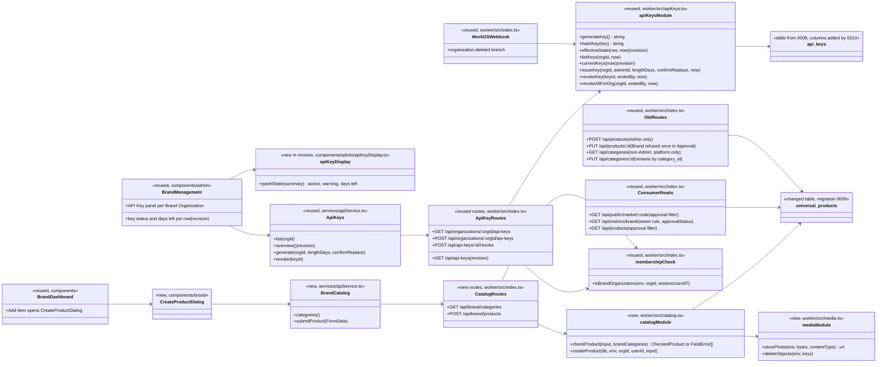
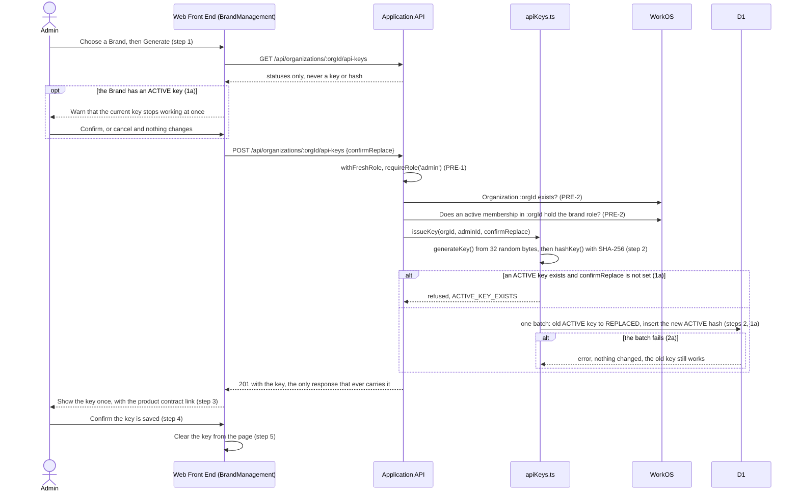
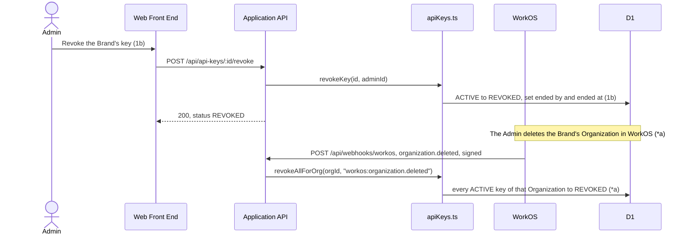
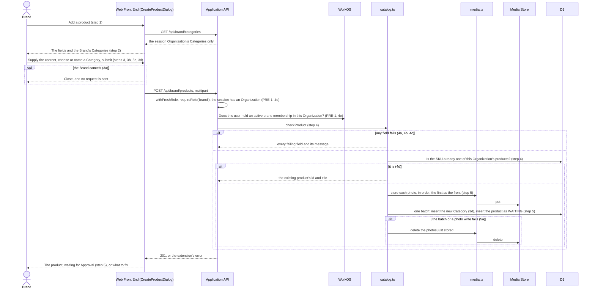

# Brand Participation Design

**Project:** Market Match
**Team:** Team 11
**Area:** `UC-BRND`

> **Realizes:** `UC-BRND-generate-api-key` (revised for use cases v0.12: `FR-API-key-expiry`, `FR-API-key-expiry-reminder`); `UC-BRND-create-product`, `FR-PROD-brand-scoped-storage`, `FR-PROD-hidden-until-approved`, `FR-PROD-server-checks` (the last three for the products a Brand creates by hand; the imports reuse the same check and storage when they are designed)
> **Depends on:** `BR-admin-issues-api-key`, `BR-api-key-expiry`, `BR-api-key-expiry-reminder`, `BR-connect-product-system`, `BR-products-brand-only`, `BR-create-organization`, `BR-admin-role`, `BR-submit-product`, `BR-approve-product`, `BR-text-card`, `BR-product-media-limit`, `BR-photo-size`, `BR-brand-categories`; `SEC-authentication`, `SEC-api-key-strength`, `SEC-api-key-ending`, `SEC-brand-isolation`; `KD-api-key-storage`, `KD-photos-copied`
> **See:** [use cases](../requirements/use-cases.md#brnd-brand-participation), [specification](../requirements/software-requirements-specification.md), [architecture-of-record](architectural-design.md)
> **Designed against:** `MM-Version`, branch `tcu-fall-2026-stage`: commit `699a0ac` for `UC-BRND-generate-api-key`; commit `e6b49ca` for `UC-BRND-create-product`
> **Built:** `UC-BRND-generate-api-key`: `MM-Version` PR #36, commit `c503e5f`. `UC-BRND-create-product`: `MM-Version` PR #49, commit `b4b26f3`

---

_**How to use this template.** Copy it to `docs/design/<area>.md`, named for the lowercase area code (`ord.md` for `UC-ORD-*`). Instructions appear in italic square brackets; leave them in place until the document is stable, because the agent reads them on every later pass. The full worked example is Project Pulse's [`not.md`](https://github.com/Washingtonwei/project-pulse/blob/main/docs/design/not.md); read it for the shape, not for the answers._

_**What this document is.** The **design-of-record** for one use case area: how the code will realize its use cases, written **before** the code and approved before anyone builds from it. It is the last document your agent reads before it writes code, so anything it leaves out, the agent invents. Your [architecture-of-record](architectural-design.md) is the map of the whole system and stops at each component's responsibility; this document goes one level down, inside one area, against real code._

_**What it is not.** A copy of your use cases. It **cites** `UC-*`, `FR-*`, and `BR-*` by identifier and never restates what the system shall do; it says only how. It is also not a transcript of the code. Once code exists, link to the files rather than describing every class, column, or getter._

_**One document per area, not per use case.** Your area gains use cases over the term. The overview, the class diagram, and the data model are **revised in place** when it does. The sequence diagrams, the API contract rows, and the test rows are **appended**, one set per use case. Never add a `## UC-…` section that repeats the whole skeleton._

_**How much to write.** Pin down what a wrong guess would break: a requirement, a business rule, a quality attribute, or the contract between two parts of your team. Leave the rest for the agent to derive while it builds: variable names, field types, exact JSON, column lengths. When you are unsure, ask which side of that line a detail falls on, not whether it is interesting._

_**Write it in this order.** Each step is one person's or one pair's work, and the order is the point:_

1. _**Sketch it yourselves first.** Before you open the agent, draw the main success scenario's sequence diagram and write the API contract rows by hand, from the use case and your architecture-of-record. Twenty minutes, on paper or in this file._
2. _**Have the agent draft it.** Give the agent this template, the use case, the business rules it cites, your architecture-of-record's section 8 (Crosscutting Concepts), and the relevant existing code, and ask for a draft of this document. Use plan mode, so it proposes before it writes._
3. _**Compare the two.** Where the agent's draft differs from your sketch, decide which is right and why. What it found that you missed goes in; what you knew that it could not have known is the context your specification is missing, so fix the specification too._
4. _**Run the questions test** (the last section) and fix what it finds._
5. _**Open a pull request.** A teammate who did not write it reviews and approves it. Nobody starts an implementation branch from this design until it is merged._

---

## Overview

_[One paragraph: what this area does, which components of your [architecture-of-record](architectural-design.md) it lives in, and what it reads from or calls in other areas. Link the container diagram rather than redrawing it. If this design changes the architecture-of-record, say so here and list the change under "Changes to the architecture-of-record" below.]_

The BRND area brings a Brand's products into Market Match and lets the Admin control who may send them. So far this document realizes two use cases. In `UC-BRND-generate-api-key` the Admin issues, replaces, and revokes the API Key a Brand's own system will use to send products (`UC-BRND-send-products`, designed later); it lives in the Identity component, which issues and ends API Keys, with the Admin's screens in the Brands tab of the Admin dashboard. In `UC-BRND-create-product` a signed-in Brand submits one product, its photos as files, to a new Catalog route. The route takes the Brand from the session's Organization and confirms with WorkOS that the user is an active `brand` member of it. It runs the Catalog's product check, the first instance of section 8.2.5, which the imports will call too. It stores the photos in the Media Store through the first code of the Media component. It then writes the product as waiting for Approval, with any new Category, in one D1 batch. Both use cases live in the Application API and the Web Front End ([containers](architectural-design.md#51-containers); [components](architectural-design.md#52-use-case-areas-and-components)). `UC-BRND-create-product` also changes two read routes outside BRND, so that no Consumer sees a waiting product (`FR-PROD-hidden-until-approved`). It also closes the old `POST /api/products` to Brands, which today puts a Brand's product live with no Approval. `UC-BRND-generate-api-key` adds one D1 table, fills section 8.2.2 of the architecture-of-record, extends section 8.2.9, and adds one risk to section 11. Its revision for use cases v0.12 (sixth client meeting), designed against `tcu-fall-2026-stage` at `e086280`, gives every key a length the Admin chooses and an expiry the server checks whenever it reads a key, adds the days left to the Admin's Brand list from one new call, and adds migration `0010`; it changes sections 8.1, 8.2.8, 8.2.9, and 11. `UC-BRND-create-product` adds two columns and an index, extends sections 8.2.1, 8.2.5, and 8.2.8, and adds one risk to section 11 (see "Changes to the architecture-of-record").

## Components & classes

_[One class diagram for the whole area, and one line per class or file saying what it does and whether it is **new** or **reused**. Show only what a reader needs to see how the parts relate: classes, their key methods, their dependencies. Fields and getters belong to the code._

_**If your repository has no code for this area yet**, which is the normal case for your proving slice, list the files you expect the agent to create, with the paths your architecture-of-record's conventions give them, and mark them all new. The agent then builds into the structure you chose rather than one it improvised.]_



- `worker/migrations/0008_api_keys.sql` (new): creates `api_keys` and its indexes (Data model below).
- `worker/src/schema.ts` (reused): adds the `apiKeys` table definition for Drizzle.
- `worker/src/apiKeys.ts` (new): the only code that creates, hashes, lists, or ends an API Key; `listKeys` selects every column but `key_hash`, so no route can return a hash. A module of its own, not more of `index.ts`, because `UC-BRND-send-products` will call `hashKey` to check a key on every sending.
- `worker/src/index.ts` (reused): the three routes, each behind the existing `withFreshRole` and `requireRole('admin')`, and a new `organization.deleted` branch in the existing `POST /api/webhooks/workos` handler.
- `services/apiService.ts` (reused): a new `ApiKeys` group using the existing `request` helper (§8.2.1, §8.2.3).
- `components/admin/BrandManagement.tsx` (reused): already receives `workosOrgs` in the Admin's Brands tab. Gains an API Key panel for each Organization in `workosOrgs`: the newest key's status and who generated or ended it and when, Generate (or Replace, with the warning of extension 1a), Revoke, and a dialog that shows a new key once. The new key lives only in the panel's component state: never in browser storage, a shared request cache, or a log, and any way the dialog or the panel closes discards it (4a). The panel is not filtered to Brands in the browser; the server's `422 NOT_A_BRAND` is the check that counts (§8.2.5). Older keys and showing a name rather than a user id are left to the build; no requirement depends on either.

For the revision of `UC-BRND-generate-api-key` (use cases v0.12), every file above is reused and changed:

- `worker/migrations/0010_api_key_expiry.sql` (new): adds `expires_at` and `first_sent_at` to `api_keys` and fills `expires_at` for existing keys (Data model below). `worker/src/schema.ts` (reused) mirrors both columns.
- `worker/src/apiKeys.ts` (reused): stays the only code that creates, lists, or ends a key. It gains the offered lengths, `API_KEY_LENGTHS_DAYS` (7, 14, 30, 45, 60, 90) and `DEFAULT_API_KEY_LENGTH_DAYS` (14), the team default in `OI-75`, defined here and nowhere else. `effectiveState(row, now)` is the one definition of whether a key works: it returns `EXPIRED` for a row whose `status` is `ACTIVE` and whose expiry is at or before `now`, where the expiry is `expires_at`, or `created_at` plus 14 days when `expires_at` is NULL (Key decisions, "Existing keys expire 14 days after they were generated"). Every list and every write in the module uses it or its SQL twin, and `UC-BRND-send-products` will call it when it checks a key (POST-5, `FR-API-key-expiry`). Every function that reads or ends keys takes `now` from its caller, so a test sets the time (§8.2.2).
- `worker/src/index.ts` (reused): the new `GET /api/api-keys`, behind `withFreshRole` and `requireRole('admin')` like the other key routes; `POST /api/organizations/:orgId/api-keys` reads and checks `lengthDays`; each route passes `new Date()` as `now`. The webhook branch is unchanged except for passing `now`.
- `services/apiService.ts` (reused): `ApiKeys.overview()`, and `generate` sends `lengthDays`. `types.ts` (reused): `ApiKeySummary` gains `EXPIRED`, `expiresAt`, `firstSentAt`, and `daysLeft`; `NewApiKey` gains `expiresAt`.
- `components/admin/BrandManagement.tsx` (reused): each Organization's row shows its current key's status and, when the server sends one, its days left (\*c1), all from one `overview()` call made with the list. The panel offers the lengths the server sent, with the default chosen (step 1), shows the expiry date beside the new key (step 3), and shows an expired key as expired with Generate, not Replace, and no warning (1c, \*b1).
- `components/admin/apiKeyDisplay.ts` (new): the panel's choices as plain functions with no React, so they are tested without a browser: whether the button generates or replaces, whether the 1a warning shows, and the text for the status and the days left.

For `UC-BRND-create-product`:

- `worker/migrations/0009_product_approval.sql` (new): adds `approval_status` and `category_id` to `universal_products` and the SKU index (Data model below). `worker/src/schema.ts` (reused) mirrors them.
- `worker/src/catalog.ts` (new): the Catalog's product check and storage, and the only place either is written (§8.2.5). `checkProduct` takes the product as submitted and the Brand's Categories, which the Category fields are checked against. It returns either every failing field with its message, not just the first, or the product checked: its text trimmed, its photos typed, and its Category resolved to one of the Brand's or a new name. `createProduct` takes only a checked product, so nothing unchecked can be stored. It takes each photo as its bytes. An uploaded file and, later, a photo downloaded from a Brand's link (`KD-photos-copied`) therefore pass the same check, which is what `UC-BRND-import-products` and `UC-BRND-send-products` will call (`FR-PROD-server-checks`). `createProduct` stores the photos, then writes the product and any new Category in one D1 batch, and removes the stored photos if the batch fails.
- `worker/src/media.ts` (new): the first code of the Media component. It writes photos to the Media Store (the `MEDIA` R2 binding) under new keys, returns the `/api/media/<key>` URL that the existing `GET /api/media/:key` serves, and deletes keys. The existing `POST /api/upload` is left as it is.
- `worker/src/index.ts` (reused): the two Catalog routes, behind `withFreshRole` and `requireRole('brand')`. `isBrandOrganization` gains an optional WorkOS user id. Given one, it asks WorkOS only about that user's memberships in the Organization (`user_id` and `organization_id`). Without one, it behaves exactly as it does today for API Keys. `GET /api/public/market/:code` and `GET /api/products` gain the approval filter (Key decisions). `GET /api/metrics/brand`, which feeds the Brand's product list, applies the same owner rule and carries each product's `approvalStatus`. `POST /api/products` drops `'brand'` from its `requireRole`. The Admin's use of it is unchanged. `PUT /api/products/:id` refuses a Brand's change to a product in Approval, `GET /api/categories` returns only `'platform'` Categories to anyone but the Admin, and `PUT /api/categories/:id` renames only its own Category's products (Key decisions).
- `services/apiService.ts` (reused): a `BrandCatalog` group. `categories()` uses the `request` helper. `submitProduct` posts `multipart/form-data` the way the existing `upload()` does, and returns the body's `error` and `fields` to the caller on failure (§8.2.1).
- `components/brand/CreateProductDialog.tsx` (new): the create form, opened by the Brand dashboard's Add Item. It needs no Market, and it never adds the product to any Market's `customItems`, which the old Add Item handler did. It asks for the fields of step 2 and switches between Card and Text Card (3b, 3c). It offers the Brand's Categories from `categories()` and a way to name a new one (3d). It shows each field's message from `fields` beside that field, keeps everything the Brand entered (the chosen photo files included) after any error, and closes without a request on cancel (3a). The existing Add Item modal in `components/BrandDashboard.tsx` stays for editing only, until `UC-BRND-update-product` is designed.
- The Brand's product list in the Brand dashboard (`components/brand/VendorItemGrid.tsx` and whatever feeds it) shows each product's approval status, so a new product appears as waiting for Approval (POST-4). The data that feeds the list must carry `approvalStatus`. A product from before Approval (`approval_status` NULL) shows no Approval status, never "Approved", because no Admin approved it.

## Sequence

_[One sequence diagram per use case for its main success scenario, plus one for each extension that does not just return an error. **Label each interaction with the use case step it implements**, so a reviewer can check that every step is realized and nothing extra was invented. Use `alt` blocks for extensions that branch off the main flow. Give each use case its own `###` heading; that heading is the anchor your traceability matrix cites.]_

### UC-BRND-generate-api-key: generating, replacing, and revoking an API Key





Extensions 4a and 5a need no flow of their own: no endpoint returns a key after the `201`, so a key not saved (4a) or leaked (5a) is replaced by generating a new one, which is extension 1a.

The generation is recorded at step 2, when the row is written, not at step 5: extension 4a treats a key the Admin never confirmed as live until a new one replaces it, so the record must exist from the moment the key does. Step 4's confirmation only clears the page; nothing is sent to the server.

Step 3's link to the published product contract waits for `UC-BRND-send-products`, whose design publishes that contract. Until then the dialog shows the key without the link; this design covers step 3 only in part, and the link has a deferred test below.

Revoking (1b) and the webhook (\*a) change only `api_keys`; no product, Inventory, or Approval row is touched, so products already received keep their Approval status (1b).

#### UC-BRND-generate-api-key revision: expiry and days left

The diagrams above are the as-built flow (`MM-Version` PR #36). The revision for use cases v0.12 changes step 1, step 3, 1a, and every write, and adds 1c, \*a2, \*b, \*c, and POST-5:

```mermaid
sequenceDiagram
    actor A as Admin
    participant WEB as Web Front End (BrandManagement)
    participant API as Application API
    participant K as apiKeys.ts
    participant WO as WorkOS
    participant DB as D1
    A->>WEB: Open the Brands tab
    WEB->>API: GET /api/api-keys (one call for every Organization)
    API->>K: currentKeys(now)
    K->>DB: each Organization's current key, never a key or hash
    API-->>WEB: lengths offered, default 14; per Organization: status as of now, expires at, days left
    WEB-->>A: Each row: key status, and days left while ACTIVE and nothing sent (*c1)
    A->>WEB: Choose a Brand, Generate, and a length (step 1)
    opt the current key is ACTIVE as of now (1a)
        WEB-->>A: Warn that the current key stops working at once
    end
    Note over WEB: An expired key shows EXPIRED and Generate, with no warning (1c, *b1)
    WEB->>API: POST /api/organizations/:orgId/api-keys {lengthDays, confirmReplace}
    API->>API: withFreshRole, requireRole('admin') (PRE-1); lengthDays in the offered list (step 1)
    API->>WO: Organization exists and is a Brand, as built (PRE-2)
    API->>K: issueKey(orgId, adminId, lengthDays, confirmReplace, now)
    K->>DB: Is a key ACTIVE and unexpired as of now? (1a, 1c)
    alt it is and confirmReplace is not set (1a)
        K-->>API: refused, ACTIVE_KEY_EXISTS
    else
        K->>DB: one batch: end any ACTIVE key past its expiry as EXPIRED (1c), end the unexpired ACTIVE key as REPLACED (1a), insert the new key with expires at = now + length (steps 1, 2)
    end
    API-->>WEB: 201 with the key and its expires at
    WEB-->>A: Show the key once with its expiry date (step 3)
```

POST-5 and \*b: from the moment a key's `expires_at` passes, `effectiveState` returns `EXPIRED` for it, whatever its `status` column still says. Every read and write in `apiKeys.ts` goes through it, so the key is refused, listed as expired, and never counted as the one active key from that moment. The row itself is written `EXPIRED` the next time anything writes that Organization's keys: a generate, a revoke, the webhook, or, later, the sending that is refused with it (`UC-BRND-send-products` 2a). Nothing runs on a schedule.

1b on an expired key: the revoke ends nothing and answers `409 KEY_ALREADY_ENDED`, and the same batch writes the key's expiry, so the record says it expired, not that the Admin revoked it.

\*a1 is as built, except that the webhook's batch first writes the expiry of any key already past it, so only keys that were still working are recorded as revoked by `workos:organization.deleted`. Its `now` is the time the delivery that succeeds arrives, not the event's own time: the keys stop working only when that batch commits, so a retry hours later records them revoked at the retry, and a key that expired between the deletion and the retry is recorded `EXPIRED` at its own expiry, because it did work until then. Rejected: the event's `created_at`, which would record a key as revoked at a moment when it still worked (§8.2.9).

\*a2 needs no code. Removing a Brand's WorkOS access while keeping its Organization sends no event this design acts on (`organization_membership.updated` or `.deleted` only resyncs a user's roles), and the key keeps working until it expires (\*b) or the Admin revokes it (1b), until `OI-77` is answered. Expiry now bounds how long such a key works: at most the length chosen, 90 days at the longest.

\*c is in part on screen now and in part waits:

- **Now:** the days left, next to each Brand in the list and in its panel, for every key that is `ACTIVE` as of now and has no `first_sent_at` (`FR-API-key-expiry-reminder`). Until `UC-BRND-send-products` is built nothing sets `first_sent_at`, so every active key shows its days left.
- **Waits on `OI-76`:** any reminder beyond the countdown (on the dashboard, by email, or both, and how many days before), and what counts as having sent. `first_sent_at` records one fact, the first sending with the key that stored at least one product, written once by `UC-BRND-send-products`. Whether that first sending is what hides the countdown, or every product the Brand meant to send must arrive first, is the client's answer; `UC-BRND-send-products`'s design applies it. Whether a key still expires once the countdown is gone is also `OI-76`; until then it does (`BR-api-key-expiry`).

### UC-BRND-create-product: creating a product



Every check runs before anything is written, so a refusal at 4a to 4e stores nothing in D1 or the Media Store. The new Category of 3d is written only in step 5's batch, never when the Brand names it, so a cancel (3a) or a failed save (5a) leaves no Category behind (`UC-BRND-create-product` 3d1, revised with this design).

Extension 4d offers to change the existing product instead. This design returns the existing product's id and title, and the dialog names it. The change itself waits for `UC-BRND-update-product`, because today's Edit puts a change live with no Approval (`BR-approve-product`). Until then this design covers 4d only in part, and the offer has a deferred test below.

POST-3, the Admin's list of products waiting for Approval, is that use case's screen (`UC-BRND-approve-product`). This design stores the product as `WAITING`, which is what that list will read. The list itself has a deferred test.

## API contract

_[One row per endpoint, scheduled job, or message this area adds or changes, appended per use case. **This section is never dropped**: before the code exists it is the only thing the person (or agent session) building the front end and the one building the back end both read. Name the caller and who may call it, the request fields, the success response, and the error each extension returns. Leave field types and exact JSON to the agent unless a wrong guess would break something, such as a format another system depends on. Use the error shape your architecture-of-record's section 8.2 fixes; do not invent one here.]_

Errors use the existing shape: a status code and `{ "error": "<message>" }`, which `services/apiService.ts` turns into a thrown error (§8.2.1). Where a code is named below, it is the `error` message, so the Admin's screen can tell the cases apart. A refusal by the Catalog's product check adds `fields`, a list of `{ field, message }`, one entry for every field that fails, so the screen can show each message beside its field (extension 4a of `UC-BRND-create-product`). `import-products` and `send-products` return the same entries for each product (§8.2.1, `FR-PROD-server-checks`).

| Endpoint or job                                                                           | Caller (who may)                                                                                                                                                                                                                                                            | Request                                                                                                                                                                                                                                                                                                       | Success                                                                                                                                                                                             | Errors, by extension                                                                                                                                                                                                                                                                                                                                                                                                                                                                                                                                                                                                                                     |
| ----------------------------------------------------------------------------------------- | --------------------------------------------------------------------------------------------------------------------------------------------------------------------------------------------------------------------------------------------------------------------------- | ------------------------------------------------------------------------------------------------------------------------------------------------------------------------------------------------------------------------------------------------------------------------------------------------------------- | --------------------------------------------------------------------------------------------------------------------------------------------------------------------------------------------------- | -------------------------------------------------------------------------------------------------------------------------------------------------------------------------------------------------------------------------------------------------------------------------------------------------------------------------------------------------------------------------------------------------------------------------------------------------------------------------------------------------------------------------------------------------------------------------------------------------------------------------------------------------------- |
| `GET /api/organizations/:orgId/api-keys`                                                  | The Admin (`withFreshRole`, `requireRole('admin')`)                                                                                                                                                                                                                         | None                                                                                                                                                                                                                                                                                                          | `200`: each key's id, status, generated by and at, ended by and at. **Never the key, never its hash.**                                                                                              | Not signed in: `401`. Not the Admin: `403`.                                                                                                                                                                                                                                                                                                                                                                                                                                                                                                                                                                                                              |
| `POST /api/organizations/:orgId/api-keys`                                                 | The Admin, as above                                                                                                                                                                                                                                                         | `confirmReplace` (boolean, optional; true with no `ACTIVE` key generates as normal)                                                                                                                                                                                                                           | `201`: the new key's id, the key itself, generated at. The only response that ever carries a key (steps 2–3).                                                                                       | 1a, an `ACTIVE` key exists and `confirmReplace` is not true: `409 ACTIVE_KEY_EXISTS`. PRE-2, no such Organization in WorkOS: `404 ORGANIZATION_NOT_FOUND`; no active membership in it holds the `brand` role: `422 NOT_A_BRAND`. 2a, saving fails: `500`, and any existing key stays `ACTIVE`. Every other WorkOS failure in either check (unreachable, any other error status, a body that cannot be read, a membership page that fails partway through paging): `502`, nothing stored; a page that fails never counts as having no `brand` membership. `401`, `403` as above.                                                                          |
| `POST /api/api-keys/:id/revoke`                                                           | The Admin, as above                                                                                                                                                                                                                                                         | None                                                                                                                                                                                                                                                                                                          | `200`: the key's id and status `REVOKED` (1b)                                                                                                                                                       | No such key: `404`. Already `REPLACED` or `REVOKED`: `409 KEY_ALREADY_ENDED`. `401`, `403` as above.                                                                                                                                                                                                                                                                                                                                                                                                                                                                                                                                                     |
| `POST /api/webhooks/workos`, event `organization.deleted` (existing endpoint, new branch) | WorkOS, verified by the existing signature check                                                                                                                                                                                                                            | WorkOS's event, `data.id` is the Organization                                                                                                                                                                                                                                                                 | Every `ACTIVE` key of that Organization becomes `REVOKED`, ended by `workos:organization.deleted` (\*a). Returns `200`.                                                                             | Revoking fails: `500`, so WorkOS retries (Key decisions). Bad or missing signature: `401`, as today.                                                                                                                                                                                                                                                                                                                                                                                                                                                                                                                                                     |
| `GET /api/brand/categories`                                                               | A Brand (`withFreshRole`, `requireRole('brand')`); the Organization comes from the session                                                                                                                                                                                  | None                                                                                                                                                                                                                                                                                                          | `200`: the id and name of each Category whose Organization is the session's (step 2)                                                                                                                | Not signed in: `401`. Not a Brand, or no Organization in the session: `403`.                                                                                                                                                                                                                                                                                                                                                                                                                                                                                                                                                                             |
| `POST /api/brand/products`                                                                | A Brand, as above, whose WorkOS membership in the session's Organization is active and holds the `brand` role. The Organization and the user come from the session, **never from the request**; an `org_id` or `brand_id` in it is ignored (`FR-PROD-brand-scoped-storage`) | `multipart/form-data`: `sku`; `cardType`, `CARD` or `TEXT_CARD`; `title`; `description`; `price` (optional); exactly one of `categoryId` (one of the Brand's Categories) or `newCategoryName` (3d); `videoLink` (optional, Cards only); `photos`, the files in order, the first the Card's front (Cards only) | `201`: the product's id, SKU, `approvalStatus` `WAITING`, and its Category's id and name (step 5)                                                                                                   | 4a, 4b, 4c: `422 INVALID_PRODUCT` with `fields`, one entry per failing field, including a `categoryId` that is not one of the Brand's Categories and a `newCategoryName` the Brand already has. 4d: `409 SKU_EXISTS` with the existing product's id and title, whether the check or the unique index found it. PRE-1 and 4e, the D1 role is no longer `brand`: `403`, from `requireRole` as on every route. The session has no Organization, or WorkOS shows no active `brand` membership for the user in it: `403 NO_BRAND_ACCESS`. A body that is not `multipart/form-data`: `400`, nothing stored. WorkOS cannot answer (unreachable, any error status, an unreadable body): `502`, nothing stored. 5a: `500` with a fixed message, nothing stored. `401` as above. |
| `POST /api/products` (existing, changed)                                                  | **The Admin only**; it allowed Brands too                                                                                                                                                                                                                                   | Unchanged                                                                                                                                                                                                                                                                                                     | Unchanged                                                                                                                                                                                           | A Brand: `403`.                                                                                                                                                                                                                                                                                                                                                                                                                                                                                                                                                                                                                                          |
| `GET /api/public/market/:code` and `GET /api/products` (existing, changed)                | Unchanged                                                                                                                                                                                                                                                                   | Unchanged                                                                                                                                                                                                                                                                                                     | Unchanged, except that a product whose `approval_status` is `WAITING` or `RETURNED` is left out for everyone but the Admin and a Brand whose Organization owns it (`FR-PROD-hidden-until-approved`). `GET /api/public/market/:code` reads no session, so it leaves them out for everyone | Unchanged                                                                                                                                                                                                                                                                                                                                                                                                                                                                                                                                                                                                                                                |
| `GET /api/metrics/brand` (existing, changed) | Unchanged: a Brand, or the Admin viewing the Brand dashboard | Unchanged | Unchanged, except that each item carries `approvalStatus` (POST-4), and a `WAITING` or `RETURNED` product counts only when the session's `workos_org_id` equals its `org_id` | Unchanged |
| `PUT /api/products/:id` (existing, changed) | Unchanged: the Admin, or a Brand that owns the product | Unchanged | Unchanged | A Brand's change to a product whose `approval_status` is not NULL: `409 PRODUCT_IN_APPROVAL`, nothing changed |
| `GET /api/categories` (existing, changed) | Unchanged: anyone | Unchanged | The Admin: every Category, `org_id` filter as today. Anyone else: only Categories whose `org_id` is `'platform'` | Unchanged |
| `PUT /api/categories/:id` (existing, changed) | Unchanged: the Admin | Unchanged | Unchanged, except that a rename changes `category` only on products whose `category_id` is this Category, and, for a `'platform'` Category, on products with no `category_id` and the old name | Unchanged |

For the revision of `UC-BRND-generate-api-key` (use cases v0.12). Where a row below names an endpoint in the table above, it supersedes that row's cells where they differ, and keeps the rest. A key's status in every response is its state as of the request (`effectiveState`), never the raw column, so a key past its expiry is `EXPIRED` in every response before its row is written, with ended by `system:api-key.expired` and ended at its expiry, exactly as the row will be written. Days left are whole days, rounded up, from the server's clock to `expires_at` (§8.2.2), so a key generated for 14 days shows 14.

| Endpoint or job | Caller (who may) | Request | Success | Errors, by extension |
| --- | --- | --- | --- | --- |
| `GET /api/api-keys` (new) | The Admin (`withFreshRole`, `requireRole('admin')`) | None | `200`: the lengths offered and the default (from `apiKeys.ts`), and, for every Organization with at least one key, its current key: the `ACTIVE` one if it is still working, or else the newest. For each: the Organization id, the key's id, status, generated at, `expiresAt`, ended at, `firstSentAt`, and `daysLeft`, which is a number only while the key is `ACTIVE` and `firstSentAt` is NULL, and NULL otherwise (\*c1). **Never the key, never its hash.** One D1 query, whatever the number of Organizations; an Organization with no key is absent, and the list shows it with no key | `401`, `403` as for the other key routes |
| `GET /api/organizations/:orgId/api-keys` (revised) | Unchanged | Unchanged | As built, plus each key's `expiresAt`, `firstSentAt`, and `daysLeft` as above; status may be `EXPIRED` (\*b1) | Unchanged |
| `POST /api/organizations/:orgId/api-keys` (revised) | Unchanged | `lengthDays`, required, one of the offered lengths (step 1); `confirmReplace` as built | `201`: as built, plus `expiresAt`, which is generated at plus `lengthDays` × 24 hours (steps 2–3, POST-5) | `lengthDays` missing, not a whole number, or not offered: `422 INVALID_LENGTH` with one `fields` entry for `lengthDays`, whose message lists the lengths offered (§8.2.1, no other property), checked before WorkOS is called, nothing stored. 1a: `409 ACTIVE_KEY_EXISTS` only when a key is `ACTIVE` and unexpired as of the request; an expired one never causes it (1c). Every other error as built |
| `POST /api/api-keys/:id/revoke` (revised) | Unchanged | Unchanged | Unchanged | A key past its expiry: `409 KEY_ALREADY_ENDED`, as for any ended key, and its row is written `EXPIRED` if it was not yet. Every other error as built |
| `POST /api/webhooks/workos`, `organization.deleted` (revised) | Unchanged | Unchanged | As built, except that a key already past its expiry is written `EXPIRED`, not `REVOKED` (\*a1) | Unchanged |
| A key check for `UC-BRND-send-products` (not an endpoint; designed with that use case) | — | — | — | It must refuse a key whose `effectiveState` is not `ACTIVE`, including one whose `status` column still says `ACTIVE` (2a, POST-5, `SEC-api-key-ending`) |

## Key decisions

_[Only the decisions a reader could not recover from the code: an invariant, who may do this and how it is enforced, a trade-off you chose, a reason you reused something rather than writing it. **Each one names what you chose, what you rejected, and why.** If you cannot name an alternative you considered, it probably was not a decision; leave it out._

_A decision that affects the whole system rather than this area is an architecture decision. It belongs in your architecture-of-record as a `KD-*` entry, not here.]_

**One active key per Brand, enforced by D1.** A partial unique index allows one `ACTIVE` row per `workos_org_id`, and replacing a key ends the old row and inserts the new one in one D1 batch, so either both happen or neither does. Rejected: checking for an active key in code and then inserting, because two requests at once could both pass the check, and a failure between the two writes could leave a Brand with two working keys or none (extension 2a). Without `confirmReplace` the insert runs alone, with no replace step, so a key made by another request since the check is refused by the index rather than ended unconfirmed; the request that loses such a race gets `500`, not `409`, and no key is stored for it.
_Superseded in part, 2026-11-18, by "An expired key ends when it is next read" below: the check for an active key counts only a key still working as of now, and the batch first writes the expiry of an `ACTIVE` key past it, so an expired key no longer holds the index's one place. The index, the batch, and the race behavior above still hold._

**A key belongs to the Brand's WorkOS Organization.** The `workos_org_id` is the same identifier products carry in `org_id`. Rejected: tying a key to the Admin who generated it or to a Brand user, because the key would then stop working when that person leaves, which the use case rules out (extension \*a).

**What counts as a Brand.** An Organization is a Brand when WorkOS lists at least one membership in it whose status is `active` and whose role is `brand` (PRE-2). The check asks WorkOS's `organization_memberships` endpoint by `organization_id`, pages until it finds one or runs out, and reads each membership's role the way the existing sign-in code does: every slug from `role` and `roles` (`workosRoleSlugs`), lowercased and trimmed, through the same `roleAliases`. Both WorkOS calls encode `:orgId` (`encodeURIComponent` in the Organization path, `URLSearchParams` for `organization_id`), and the key is stored under exactly the string both checks used; WorkOS's `404` rejects any id that is not an Organization, so the route adds no format check of its own. WorkOS Organizations carry no type, and Vendors have Organizations too. Rejected: accepting any Organization, which would give a Vendor a key for sending products (`BR-products-brand-only`); D1's `users.role` and `users.roles`, this design's first rule, because they hold a user's roles across all their Organizations while `workos_org_id` holds only one of them (the first non-Consumer one at `699a0ac`; the one chosen at sign-in since the client's `main` #39), so a Vendor Organization passes when one of its users is a Brand elsewhere, and a Brand fails when its users signed in to another Organization or were never synced; and the Admin marking Organizations as Brands in Market Match, which adds a column, a screen, and a second record of roles WorkOS already holds. Until the client answers `OI-60`, this is a team decision. Decided by Matthew Stafford, 2026-10-28; revised 2026-11-04.

**A deleted Organization's keys are revoked by the WorkOS webhook.** The existing, signed `POST /api/webhooks/workos` gains an `organization.deleted` branch that revokes every active key of that Organization. Rejected: asking WorkOS on every sending whether the Organization still exists, which puts an external call on every request (`KD-api-key-storage`); and relying on the Admin to revoke the key by hand before deleting an Organization, which he can forget. Market Match has no route that deletes an Organization (only `GET /api/organizations` at `699a0ac`); the Admin deletes one in the WorkOS dashboard, so the webhook is the only path. A delete route added later revokes the keys itself before it returns.

**The `organization.deleted` branch returns `500` when revoking fails.** The handler's `catch` returns `200` on every error today, so WorkOS does not retry; this branch alone returns `500`, so WorkOS retries until the keys are revoked. Revoking again changes nothing, so a retry is safe. The other branches keep returning `200` on error. Rejected: the existing `200`, which would leave a deleted Brand's key working with no retry (`SEC-api-key-ending`).

**A key ends once, in one conditional write.** Revoking, replacing, and the webhook end a key with an update that matches only while it is still `ACTIVE` (`WHERE id = ? AND status = 'ACTIVE'`, or by `workos_org_id` and `status = 'ACTIVE'`). When a revoke changes no row, it returns `409 KEY_ALREADY_ENDED`. Rejected: reading the status and then updating, because a revoke and a replace arriving together could both end the same row, and the second would overwrite who ended it and when (§8.2.9).
_Superseded in part, 2026-11-18, by "An expiry is written once, as the moment it happened" below: revoking and replacing now match only a key that is `ACTIVE` and unexpired as of now, and a key past its expiry is ended as `EXPIRED` instead. Ending each key once, in one conditional write, still holds._

**Replacing a key needs confirmation on the server.** `POST` refuses with `409 ACTIVE_KEY_EXISTS` unless `confirmReplace` is true, so the warning of extension 1a cannot be skipped by calling the API directly. Rejected: warning only in the browser.

**The key row is its own audit record.** Who generated a key and when are written once, at generation; who ended it and when, once, when it ends; neither is overwritten afterwards (§8.2.9). Rejected: a separate audit log table, which no other area needs yet.

**The key format.** 32 bytes from `crypto.getRandomValues`, 256 bits (`SEC-api-key-strength`), encoded as base64url without padding (43 characters), stored only as its SHA-256 hash in lowercase hexadecimal. The hash is taken over the UTF-8 bytes of the key string exactly as the `201` returns it, and only `hashKey` computes it, so `UC-BRND-send-products` hashes a received key the same way; if they differ, no key ever works. A plain hash is enough because a 256-bit random key cannot be guessed (`KD-api-key-storage`). The key has no prefix. Its id comes from `crypto.randomUUID()`, never from the key, and no part of the key other than its hash is stored or returned after the `201`, so no hint such as its last characters.

The decisions below are for the revision of `UC-BRND-generate-api-key` (use cases v0.12). The decisions above still hold except where a note marks one superseded in part. Decided by Matthew Stafford, 2026-11-18.

**An expired key ends when it is next read.** A key is expired from the moment `expires_at` passes, decided by `effectiveState(row, now)`, the one definition the routes, the list, and later `UC-BRND-send-products` all use. Every write to an Organization's keys (generate, revoke, the webhook) first runs, in the same D1 batch, an update that writes the expiry of each of its `ACTIVE` keys past it. The check for an active key before generating (1a) counts only a key still working as of now, so an expired key never returns `409` or the replace warning (1c), and the expiry is written before the insert, so the partial unique index never sees two `ACTIVE` rows. Rejected: a scheduled sweep (a Cloudflare Cron Trigger and a `scheduled` handler), because the Worker has neither today (`export default app` at `e086280`), adding one changes the deploy configuration on the client's account, and between two runs an expired key would still pass the check, so every check would have to compare `expires_at` anyway (`SEC-api-key-ending`: refused from the moment it ends). Also rejected: putting the time into the partial index (`WHERE status = 'ACTIVE' AND expires_at > …`), because SQLite does not allow the current time in an index's `WHERE`. Also rejected: writing the expiry on `GET`, because a read that writes makes every list a write, and the state shown is the same either way. Each function takes `now` from its route (`new Date()`), so a test sets the time; the comparison is between ISO 8601 strings from `toISOString()`, never SQLite's `datetime('now')`, whose different format would compare wrongly (§8.2.2).

**An expiry is written once, as the moment it happened.** The expiry update sets `status` `EXPIRED`, `ended_by` `system:api-key.expired`, and `ended_at` the key's own `expires_at`, and it matches only `WHERE status = 'ACTIVE' AND` the expiry `<= now`, so it writes each key once and a second run changes nothing (§8.2.9). A revoke or replace then matches only `status = 'ACTIVE' AND` the expiry `> now`, so an expired key is never recorded as revoked or replaced by the Admin. Rejected: `ended_at` as the moment the server noticed, because it would depend on when anyone next looked, and the record would not say when the key stopped working. Also rejected: `ended_by` NULL for an expiry, because every ended key would then no longer say who or what ended it; `system:api-key.expired` follows §8.2.9's system-event names, and the panel shows it as "Expired".

**The length is checked on the server, against one list.** `POST` accepts only a `lengthDays` in `API_KEY_LENGTHS_DAYS`, and the panel offers exactly the lengths and default that `GET /api/api-keys` returns from that list, so answering `OI-75` changes one constant and its tests. There is no default on the server: a request without `lengthDays` is refused, because step 1 has the Admin choose. Rejected: a copy of the list in the browser, which would drift from the server's on the day `OI-75` is answered. Also rejected: any number of days, and "never", which `OI-75` leaves open and whose team default rules out. A day is 24 hours from the moment the key is generated, in UTC; the expiry is not rounded to midnight in anyone's time zone.

**Existing keys expire 14 days after they were generated.** Migration `0010` sets `expires_at` to `created_at` plus 14 days, the default length in `OI-75`, for every `ACTIVE` key, and leaves it NULL for keys already ended, which never had a length. A key older than 14 days is then expired at once; that breaks nothing, because nothing accepts a key until `UC-BRND-send-products` is built, and the Admin generates a new one (1c). No `ACTIVE` row should have NULL `expires_at` after `0010`, but if one does, every check and every write reads its expiry as `created_at` plus 14 days, the same rule the migration applies: in SQL, `COALESCE(expires_at, strftime('%Y-%m-%dT%H:%M:%fZ', created_at, '+14 days'))`, the one expression `apiKeys.ts` uses for the expiry wherever it compares one, and `ended_at` is that same value. Such a row therefore expires, is written `EXPIRED` once, and never holds the index's one place. Rejected: reading NULL as expired at once in checks but not in writes, which left the row `ACTIVE` in D1 so that every new key for that Brand failed with `500`; and recording the moment the server found it, which §8.2.2 rules out for a missing time. Rejected: NULL meaning "never expires", which `BR-api-key-expiry` rules out for every key. Also rejected: the migration's own time plus 14 days, which differs between the local, preview, and production databases; and revoking every existing key in the migration, which would record a revocation nobody made.

**One call gives the Brand list every key's status.** `GET /api/api-keys` answers, in one D1 query, each Organization's current key with its status, expiry, and days left, and the Brands tab calls it once next to the existing `GET /api/organizations`; the panel keeps its per-Organization call for the key history. The days left come from the server's clock, so the list, the panel, and the tests agree. Rejected: one `GET /api/organizations/:orgId/api-keys` per row, which is a request per Organization on every visit. Also rejected: adding the key status to `GET /api/organizations`, which reads WorkOS, so a WorkOS failure would also hide every key's status. Also rejected: counting the days in the browser, whose clock may be wrong. The Brands tab calls it when it opens, and both it and the panel's call run again after every generate and revoke and when a panel opens; there is no timer, so a screen left open past an expiry shows the old status until one of those, and the server's answer to the next action is the one that counts (1c). The current key is the `ACTIVE` one still working, else the one with the latest `created_at`. An Organization in the response that `GET /api/organizations` no longer lists is not shown. If the call fails, the tab shows the error and offers no Generate, since it has no lengths to offer.

**The key records when its Brand first sent products.** `first_sent_at` is NULL until the first sending with that key stores at least one product, and `UC-BRND-send-products` writes it once, matching `WHERE first_sent_at IS NULL`. The days left show while it is NULL (\*c1). Rejected: working it out from the products each time the list loads, which ties this list to how `UC-BRND-send-products` records a sending, not yet designed. Also rejected: a yes-or-no flag, which loses when. If `OI-76`'s answer is that every product the Brand meant to send must arrive, Market Match cannot see that from a sending, and that use case adds what the answer needs.

**Removing a Brand's WorkOS access does not end its key** (\*a2). The webhook still ends keys only on `organization.deleted`; the membership events still only resync a user's roles. Rejected: ending a Brand's keys when a membership event leaves its Organization with no active `brand` membership, because whether removing access should end the key is `OI-77`, and what "removing access" is in WorkOS is not yet known. Expiry now bounds the gap, and the Admin can revoke the key (1b).

The decisions below are for `UC-BRND-create-product`. Decided by Matthew Stafford, 2026-11-16.

**A Brand is its Organization.** A product's `org_id` is the session's `workos_org_id`, and its Categories are those whose `org_id` is the same. Its `brand_id` is the user who submitted it, kept because the Brand dashboard and `/api/metrics/brand` filter on it today. Rejected: `brand_id` alone, because a Brand with two users would then have two Inventories (`FR-PROD-brand-scoped-storage` takes the Brand from the Organization). Also rejected: today's fallback to `org_id` `'platform'` when the session has no Organization, because it puts the product in nobody's Inventory. Such a Brand gets `403 NO_BRAND_ACCESS` instead.

**PRE-1 and 4e are checked with WorkOS on every submission.** After `withFreshRole` and `requireRole('brand')`, the route asks WorkOS whether this user's membership in the session's Organization is `active` and holds the `brand` role. It reads roles the way "What counts as a Brand" does. The user's WorkOS id is read from D1 by the session's user id. Rejected: the D1 role alone, for the reason "What counts as a Brand" gives. D1 holds a user's roles across all their Organizations, so a user who is a Brand in one and a Vendor in another, signed in to the Vendor Organization, would pass and fill that Organization's Inventory (`BR-products-brand-only`, `OI-63`). D1 also changes only when the membership webhook arrives. Cost: while WorkOS cannot answer, no Brand can create a product (`502`).

**Photos are sent with the product, in the same request.** The dialog posts the fields and the photo files together as `multipart/form-data`. The server checks each photo's type from its first bytes (JPEG starts `FF D8 FF`, PNG `89 50 4E 47 0D 0A 1A 0A`) and its size from its byte length. It stores the photos only after every check has passed. Rejected: uploading each photo first through the existing `POST /api/upload`, because a cancel (3a) or a refusal would leave photos in the Media Store that no product uses, and the server would have to read them back to check them. Also rejected: trusting the file's declared type, which the browser takes from its name. Photos given as links are the imports' route (`KD-photos-copied`). They pass the same check once downloaded. Each photo is stored with the content type its first bytes showed, `image/jpeg` or `image/png`, under a key ending `.jpg` or `.png` to match; the declared type and the file's name are never stored, because `GET /api/media/:key` serves an object from the app's own address with the type it was stored with.

**What the check enforces.** All of this lives in `checkProduct` and nowhere else:

- Every text field (`sku`, `title`, `description`, `newCategoryName`) has its surrounding whitespace removed before any check, the 100-character limit included, and is stored that way; a value of only spaces is missing.
- A photo that fails on its type or size is named by its position, `photos.0` to `photos.2`; the number of photos is named `photos`. The imports use the same names (`FR-PROD-server-checks`).
- `sku`: required; surrounding whitespace removed; compared exactly, letter case included (`OI-74`).
- `title`: required; at most 100 characters (the use case leaves the limit to the design).
- `description`: required; no limit.
- `price`: optional; a number ≥ 0.
- The Category: neither `categoryId` nor `newCategoryName`, or both, fails as `categoryId`, so every route names the same field (`FR-PROD-server-checks`). Decided during the build, 2026-11-18.
- A Card: one to three photos, each JPEG or PNG and smaller than 3,000,000 bytes, and at most one `videoLink`, an `https` link whose host is `youtube.com`, `www.youtube.com`, `m.youtube.com`, `youtu.be`, `vimeo.com`, or `player.vimeo.com`.
- A Text Card: any photo or video link is a failing field, not ignored, so a sender learns the content was not taken (3b).
- 3 MB is read as 3,000,000 bytes, the smaller of the two readings, so every photo accepted is under 3 MB whichever way a Brand's computer counts.

**Nothing is half-stored.** `createProduct` writes the photos to the Media Store first, then the new Category (3d) and the product in one D1 batch. If the batch fails, it deletes the photos it just wrote and answers `500` (5a). If that delete fails too, it logs the keys, leaving a photo no product uses, never a product without its photos. Rejected: the D1 batch first, because the product would exist, and could be listed, before its photos did.

**A new Category is created at submission, not when it is named.** The dialog holds a new Category's name until submission, and the server inserts it in the product's batch. A cancel (3a) or a failed save (5a) therefore leaves no Category behind. This needed `UC-BRND-create-product` 3d1 revised, because it said the Category is created when named, which contradicts 5a. A new name equal to one of the Brand's own Categories, ignoring surrounding spaces and letter case, fails as the `newCategoryName` field rather than making a second Category of the same name. No unique index guards this. Two identical submissions share a SKU, so the SKU index fails one batch and its Category with it; only two different products naming the same new Category in the same moment could make two, which breaks no requirement. Rejected: a unique index on the Organization and the name, because Categories from before may already repeat names and the migration would fail. Decided by Matthew Stafford, 2026-11-18.

**Approval has its own column.** `approval_status` is `WAITING`, `APPROVED`, or `RETURNED`, apart from the existing `status`. Rejected: adding `WAITING` to `status`. Every reader treats any `status` but `ARCHIVED` or `INACTIVE` as live and would show the waiting product. A Brand can also set `status` through `PUT /api/products/:id`, so it could approve its own product.

**Products from before Approval stay live.** Existing products get `approval_status` NULL, meaning they predate Approval, and they are shown as they are today. Rejected: setting them to `APPROVED`, which would record an Approval the Admin never gave (§8.2.9). Also rejected: setting them to `WAITING`, which would empty every running Market at once.

**Consumers see only approved products and products from before Approval.** `GET /api/public/market/:code` and `GET /api/products` leave out a `WAITING` or `RETURNED` product for every caller except the Admin and the Brand whose Organization owns it. Today `GET /api/products` filters nothing for a Consumer, so any signed-in Consumer could list every product. Rejected: filtering only Consumers, because a Vendor's view would then depend on the Market query never matching a waiting product. The Brand that owns a product with an `approval_status` is the one whose session `workos_org_id` equals its `org_id`, and nothing else. Today's other Brand matches in `GET /api/products` (`brand_id` or `org_id` equal to the user's id, a Market the Brand owns) still apply to products from before Approval, never to a waiting or returned one, because a user may sign in to another Organization and still match on `brand_id` (`SEC-brand-isolation`). `GET /api/metrics/brand` uses the same matches to feed the Brand's product list, so it applies the same owner rule. Rejected: leaving it as it is, which would show a waiting product to its submitter while signed in to another Organization. Decided by Matthew Stafford during the build, 2026-11-18.

**One SKU per Brand.** The check looks for the SKU among all the Organization's products, those from before Approval included, and answers `409 SKU_EXISTS` (4d). The Organization's products are those whose `org_id` is the session's Organization; a product saved under `org_id` `'platform'` is in no Brand's Inventory ("A Brand is its Organization") and does not count. A partial unique index on (`org_id`, `sku`) where `approval_status` is not NULL stops two submissions at once from both passing; the one that loses gets the same `409`. Rejected: the index over every row, because products from before Approval may already repeat SKUs (the server made up `SKU-<timestamp>` and `CSV-…` SKUs and never checked them), and the migration would then fail.

**A product records its Category by id, and by name as today.** `category_id` is the Category the Brand chose (`BR-brand-categories`). `category`, the name, is still written, because every Market query, the Consumer's deck, and the dashboards match products by Category name today. Rejected: the name alone, because once Brands create Categories, two Brands' Categories of the same name cannot be told apart. Also rejected: the id alone, which every existing reader would miss. Moving the Market queries to the id is `RISK-category-name-join`.

**The old route is closed to Brands.** `POST /api/products` keeps serving the Admin's Global Inventory but refuses Brands. Otherwise a Brand could still create a live product with no Approval, and POST-2 would hold only for the dialog. Rejected: closing `POST /api/products/bulk` and the Brand's `PUT /api/products/:id` here too. Those are the spreadsheet import and the product change, which `UC-BRND-import-products` and `UC-BRND-update-product` replace, and closing them now would take features away from Brands before their replacements exist (`TD-products-live-unchecked`).

**A Brand cannot change a product in Approval through the old route.** `PUT /api/products/:id` refuses a Brand's change to any product whose `approval_status` is not NULL with `409 PRODUCT_IN_APPROVAL` and changes nothing. The route lets a Brand set `org_id`, `brand_id`, `category`, `media`, and `primary_image` with no check, so it could move a waiting product into another Brand's Inventory or swap in photos the check refused, which the Admin would then approve (`FR-PROD-server-checks`, `FR-PROD-brand-scoped-storage`, `SEC-brand-isolation`, `BR-photo-size`). Products from before Approval stay editable as today, and the Admin's use is unchanged. Rejected: closing the route to Brands, which takes away changing older products before `UC-BRND-update-product` exists; and ignoring only `org_id` and `brand_id`, which still lets unchecked photos reach the Admin. Decided by Matthew Stafford, 2026-11-18.

**Renaming a Category renames only its own products.** `PUT /api/categories/:id` renames the products whose `category_id` is that Category. Products from before (`category_id` NULL) are still matched by the old name, as today, but only when the renamed Category's `org_id` is `'platform'`. Today it renames every product whose `category` equals the old name in every Organization, so renaming one Brand's "Shirts" would rename another Brand's (`BR-brand-categories`, `SEC-brand-isolation`). Rejected: matching by `category_id` alone, which would drop every product from before out of its Markets on a rename. Decided by Matthew Stafford, 2026-11-18.

**Only the Admin lists every Organization's Categories.** `GET /api/categories` returns every Category to the Admin, and only those whose `org_id` is `'platform'` to anyone else, signed in or not; a Brand reads its own through `GET /api/brand/categories`. Today it returns every Category to any caller, so a Brand's Category names would reach competing Brands ("A Brand sees and uses only its own Categories" in `UC-BRND-create-product`). An existing Brand starts with no Categories of its own and names one through 3d; the Admin's `'platform'` Categories are not offered to it (`BR-brand-categories`). Rejected: closing the route to all but the Admin, because the app loads it for every user at start. The Consumer's deck resolves a Market's Category ids to names through this list (`App.tsx`), so it will not find a Brand's Category once its products are approved; that joins `RISK-category-name-join`. Decided by Matthew Stafford, 2026-11-18.

**Submitting is not a change to Approval.** Storing a product as `WAITING` writes no audit record of its own; the row's `brand_id` and `created_at` say who submitted it and when. The record §8.2.9 requires starts with the first change to Approval, in `UC-BRND-approve-product`, whose design also settles that the Admin's `PUT /api/products/:id` can overwrite `brand_id`. Rejected: an audit table now, which nothing in this use case would write to.

## Data model

_[The **change** this area makes to the data: new tables or entities, new columns, the migration that adds them. Draw an ER diagram when there is more than one new table. Do not redraw the domain model; your [specification](../requirements/software-requirements-specification.md) owns it, so link it and show only the change. If the area changes nothing, say "No change" and give the reason in one line; that is a design decision too.]_

One new table, `api_keys`, added by `worker/migrations/0008_api_keys.sql` and mirrored in `worker/src/schema.ts`:

| Column                     | Meaning                                                                | Constraint                                            |
| -------------------------- | ---------------------------------------------------------------------- | ----------------------------------------------------- |
| `id`                       | The key's identifier, shown to the Admin                               | Primary key                                           |
| `workos_org_id`            | The Brand's Organization                                               | Not null; indexed                                     |
| `key_hash`                 | SHA-256 of the key, hexadecimal                                        | Not null; unique                                      |
| `status`                   | `ACTIVE`, `REPLACED`, or `REVOKED`                                     | Not null                                              |
| `created_by`, `created_at` | The Admin's D1 `users.id` (the session's `user.id`); when, UTC         | Not null; written once; no foreign key                |
| `ended_by`, `ended_at`     | The Admin's D1 `users.id`, or `workos:organization.deleted`; when, UTC | Null until the key ends; written once; no foreign key |

`created_by` and `ended_by` carry no foreign key, unlike the schema's other user columns: `ended_by` can hold `workos:organization.deleted`, which is not a user, and the audit record must outlive the user, since `DELETE /api/users/:id` exists and D1 enforces foreign keys.

A partial unique index on `workos_org_id` where `status = 'ACTIVE'` keeps one active key per Brand: `CREATE UNIQUE INDEX … ON api_keys (workos_org_id) WHERE status = 'ACTIVE'`. Without the `WHERE`, every replace fails. `0008` is the next number (`worker/migrations/` holds `0001` to `0007` at `699a0ac`). Write its SQL by hand, as every existing migration is; never run `npm run db:generate`, because `drizzle.config.ts` still points at PostgreSQL and `server/`. Mirror the index in `schema.ts` with `.where(…)`.

Timestamps are UTC ISO 8601 text (§8.2.2). Both `created_at` and `ended_at` are set in code with `new Date().toISOString()`, with no column default, so the table holds one format: the schema's `datetime('now')` defaults write a different string (`YYYY-MM-DD HH:MM:SS`) that browsers may read as local time.

For the revision of `UC-BRND-generate-api-key`, `worker/migrations/0010_api_key_expiry.sql` adds two columns to `api_keys`, mirrored in `worker/src/schema.ts`:

| Column | Meaning | Constraint |
| --- | --- | --- |
| `expires_at` | When the key stops working: generated at plus the length the Admin chose (POST-5), UTC | Null allowed only for keys ended before `0010`; every key generated after it sets one; written once, at generation, never extended (`OI-78`) |
| `first_sent_at` | When the first sending with this key stored at least one product (\*c) | Null until then; written once, by `UC-BRND-send-products` |

`status` gains `EXPIRED`; the column has no check constraint, so only its comment and `ApiKeyStatus` change. `ended_by` may also hold `system:api-key.expired`, with `ended_at` equal to `expires_at`. The partial unique index is unchanged.

The migration fills `expires_at` for every `ACTIVE` row with `strftime('%Y-%m-%dT%H:%M:%fZ', created_at, '+14 days')`, which writes the same format as `toISOString()`, so the text comparison against `now` holds for old and new rows alike; ended rows keep NULL (Key decisions). It adds no index: the lookups stay by `workos_org_id`, already indexed. `0010` is the next number: `0009` is `UC-BRND-create-product`'s (`MM-Version` PR #49), and no other open pull request in `MM-Version` adds a migration (checked 2026-11-18). Write its SQL by hand, as for `0008`.

For `UC-BRND-create-product`, `worker/migrations/0009_product_approval.sql` changes `universal_products` and is mirrored in `worker/src/schema.ts`:

| Column or index                                                                               | Meaning                                                                       | Constraint                                                                                                                                                 |
| --------------------------------------------------------------------------------------------- | ----------------------------------------------------------------------------- | ---------------------------------------------------------------------------------------------------------------------------------------------------------- |
| `approval_status`                                                                             | `WAITING`, `APPROVED`, or `RETURNED`; NULL for a product from before Approval | Null allowed; this use case writes only `WAITING`; only `UC-BRND-approve-product` changes it                                                               |
| `category_id`                                                                                 | The Category the Brand chose                                                  | Null allowed, for products from before it; no foreign key, because the Admin's `DELETE /api/categories/:id` would then fail for any Category with products |
| `CREATE UNIQUE INDEX … ON universal_products (org_id, sku) WHERE approval_status IS NOT NULL` | One SKU per Brand among the products that went through Approval               | Partial, for the reason in Key decisions                                                                                                                   |

A product this use case creates also sets `org_id` and `brand_id` as in Key decisions; `category` to the Category's name; `media` to `{ type, images, videoUrl }` with `type` `image` for a Card and `text` for a Text Card, the form the Consumer's deck already reads (`deriveItemType` in `App.tsx`); `primary_image` to the first photo; `marketplace_id` NULL, because a product reaches a Market through its Category once approved; `status` `ACTIVE`; and `source` `BRAND_UPLOAD`. `created_at` and `updated_at` are set in code with `new Date().toISOString()`, as for `api_keys`. A new Category is a `categories` row with the session's `org_id`, its `created_at` set the same way. Write the SQL by hand, as for `0008`. The number is `0009` because `0008` is `api_keys`.

## Reuse & cross-cutting

_[Which existing services, components, and conventions this area uses rather than rebuilding: authentication, the error handler, email, the clock, another area's service. Cite your architecture-of-record's section 8.2 for each convention by name rather than restating it.]_

- **Authentication and authorization:** the existing `authMiddleware` session, re-read from D1 by `withFreshRole` so an Admin whose role was removed is refused at once, then `requireRole('admin')` (§8.1).
- **WorkOS:** the Organization lookup follows the existing `GET /api/organizations` route, which calls WorkOS's REST API with `WORKOS_API_KEY`; the Brand test calls `organization_memberships` with the same key and reads roles with the existing `workosRoleSlugs` and `roleAliases`; the webhook reuses the existing signature check (`verifyWorkOSSignature`).
- **Front end calls** go through `services/apiService.ts` (§8.2.1, §8.2.3).
- **Error handling** (§8.2.1), **time** (§8.2.2), **validation on the server** (§8.2.5), **logging**: never log a key or its hash, only the key's id and the Organization id; at `699a0ac` no middleware logs request or response bodies, so the `201` reaches no log (§8.2.7); a failed save is caught in the route and answered with a fixed `500`, because `app.onError` returns and logs the error's stack and a failed plain insert's Drizzle message lists its parameters, the new key's hash among them; that `catch` logs a fixed message, the Organization id, and only the SQLite cause's message, which names the column but no value, or else the error's name: never the error's own message, its stack, or the whole error, **persistence**: migration `0008`, the D1 batch (§8.2.8), **auditing** (§8.2.9), **testing** by hand (§8.2.10).
- For the revision: **time** from the route's `new Date()`, passed down as `now`, compared as ISO 8601 text (§8.2.2); **validation** of the length in `apiKeys.ts`, with the field list (§8.2.1, §8.2.5); **persistence**: migration `0010`, the expiry written in the same batch as every other key write (§8.2.8); **auditing**: the expiry's system ender (§8.2.9); **logging** unchanged; **testing**: the rows below are automated Vitest tests (§8.2.10, `KD-test-framework`), and they need its setup pull request in `MM-Version` (#50) first. This revision is built only after that pull request merges, so its tests ship in the pull request that builds it (§8.2.10); building it before, with rows run by hand, is not done.

For `UC-BRND-create-product`:

- **Authentication and authorization:** `withFreshRole`, then `requireRole('brand')` (§8.1), then the WorkOS membership check through `isBrandOrganization` with its new user filter, reading roles with `workosRoleSlugs` and the role alias map.
- **Media:** photos are served by the existing `GET /api/media/:key`; only `media.ts` writes them.
- **Responses:** products are returned through the existing `serializeProduct`. The dialog posts through `services/apiService.ts`, as `upload()` already does for files (§8.2.3).
- **Error handling:** the field list of §8.2.1. **Validation:** in the Catalog only (§8.2.5). **Time:** §8.2.2.
- **Logging:** never a field's value. Log only the Organization id, the product id, and the photo keys, and on a failed save only the SQLite cause's message or the error's name, as the API Key route does, because a failed insert's Drizzle message lists the product's content (§8.2.7).
- **Persistence:** migration `0009` and one D1 batch per product (§8.2.8). **Testing** by hand (§8.2.10).

## Tests

_[One row per flow: the main success scenario and **every** extension of every use case this document realizes, appended per use case. Name the level (unit or integration) and what the test asserts. No code. This list is the definition of done that the reviewer approves; the agent writes these tests when it builds, and a reviewer can see at a glance whether an extension has no test._

_Each row is an automated Vitest test whose name begins with the row's ID, written in the pull request that builds it (§8.2.10, `KD-test-framework`); Worker tests stub WorkOS and pass the time as `now`, and none reaches WorkOS, the client's Cloudflare account, or a secret. A row marked **manual** needs a real browser or a real WorkOS sign-in: it is run by hand against `npm run dev` and its result recorded in the pull request. A **deferred** row waits for the use case it names. Rows marked (regression) cover behavior already built (`MM-Version` PR #36, run by hand there) that a change could break. The `UC-BRND-create-product` rows were run by hand in its build pull request, before the framework existed, and become automated tests when that slice is next changed (`TD-no-tests`).]_

| Use case, flow                                                 | Level       | Asserts                                                                                                                                                                                                                                                                                                                                                                                                                                                                                                                                                |
| -------------------------------------------------------------- | ----------- | ------------------------------------------------------------------------------------------------------------------------------------------------------------------------------------------------------------------------------------------------------------------------------------------------------------------------------------------------------------------------------------------------------------------------------------------------------------------------------------------------------------------------------------------------------ |
| `GAK-step-1` UC-BRND-generate-api-key step 1, the lengths | integration | `GET /api/api-keys` returns the lengths 7, 14, 30, 45, 60, and 90 days and the default 14, equal to `API_KEY_LENGTHS_DAYS` and `DEFAULT_API_KEY_LENGTH_DAYS`; `POST` with each of them returns `201` |
| `GAK-step-1-length-refused` UC-BRND-generate-api-key step 1, length checked on the server | integration | `POST` with `lengthDays` missing, `0`, `15`, `365`, `14.5`, `"14"`, or `null`: `422 INVALID_LENGTH` with one `fields` entry, for `lengthDays`, whose message lists 7, 14, 30, 45, 60, and 90; no row stored; the WorkOS stub was not called |
| `GAK-step-2` UC-BRND-generate-api-key step 2 (regression) | integration | For a Brand with no key: `201` carries a 43-character base64url key (256 bits); D1 holds one `ACTIVE` row whose `key_hash` is the SHA-256 of that key, and no column holds the key |
| `GAK-step-3` UC-BRND-generate-api-key step 3, the expiry | integration | With `now` fixed and `lengthDays` 14, the `201`'s `expiresAt` and the row's `expires_at` are both exactly `now` plus 14 × 24 hours, as `toISOString()` text |
| `GAK-step-3-shown` UC-BRND-generate-api-key step 3, on screen | manual | In a browser: the new key dialog shows the key and its expiry date and time in the viewer's time zone (§8.2.2), with the length chosen at step 1 preselected at 14 |
| `GAK-step-3-link` UC-BRND-generate-api-key step 3, product contract link | deferred | Needs the contract `UC-BRND-send-products` publishes; added to this list when it is designed |
| `GAK-steps-4-5` UC-BRND-generate-api-key steps 4 and 5, shown once (regression) | manual | In a browser: the panel shows the key once and clears it after confirmation; after closing the drawer or reloading the page, no key is shown and none is in the browser's storage |
| `GAK-POST-4` UC-BRND-generate-api-key POST-4, the record (regression) | integration | After generating, the row's `created_by` is the Admin's D1 `users.id` and `created_at` is `now`; neither changes after the key is replaced, revoked, or expires |
| `GAK-POST-1` UC-BRND-generate-api-key POST-1, one active key (regression) | integration | Inserting a second `ACTIVE` row for one Organization directly fails on the partial unique index. Two `POST`s without `confirmReplace` at once, for a Brand with no key and for one whose only key has expired: one `201`, one `500`, and one `ACTIVE` row |
| `GAK-1a` UC-BRND-generate-api-key 1a (regression) | integration | With a key `ACTIVE` and unexpired, `POST` without `confirmReplace`: `409 ACTIVE_KEY_EXISTS`, nothing changed; with it: the old row is `REPLACED`, ended by the Admin at `now`, and the new row is the only `ACTIVE` one |
| `GAK-1a-panel` UC-BRND-generate-api-key 1a, the warning | unit | `apiKeyDisplay`: for a current key `ACTIVE` as of now, the action is Replace and the warning shows; for no key, `REVOKED`, `REPLACED`, or `EXPIRED`, the action is Generate and no warning shows |
| `GAK-1b` UC-BRND-generate-api-key 1b (regression) | integration | Revoking sets `REVOKED`, ended by the Admin at `now`, and leaves every `universal_products` row unchanged; revoking again: `409 KEY_ALREADY_ENDED`, ended by and at unchanged; an unknown id: `404` |
| `GAK-1b-expired` UC-BRND-generate-api-key 1b on an expired key | integration | Revoking a key whose `status` is still `ACTIVE` but whose `expires_at` has passed: `409 KEY_ALREADY_ENDED`; the row is `EXPIRED`, ended by `system:api-key.expired` at its `expires_at`, never `REVOKED` |
| `GAK-1c` UC-BRND-generate-api-key 1c | integration | With the clock at the old key's `expires_at` exactly, and again one hour later: `POST` without `confirmReplace` returns `201`; the old row is `EXPIRED`, ended by `system:api-key.expired` at its `expires_at`; the new row is the only `ACTIVE` one. With the clock one millisecond before `expires_at`: `409 ACTIVE_KEY_EXISTS`. With `confirmReplace` on an expired key: the old row is `EXPIRED`, not `REPLACED` |
| `GAK-2a` UC-BRND-generate-api-key 2a (regression) | integration | The test makes the batch fail with no failure hook in production code (for example, by stubbing `crypto.getRandomValues` so the new key's hash equals a stored one): `500` with the fixed message; the old key is still the one `ACTIVE` row, and an expired old key's row is still unwritten (the batch rolled back); the logged line holds no key or hash |
| `GAK-4a-5a` UC-BRND-generate-api-key 4a and 5a, never shown again (regression) | integration | After generating, replacing, revoking, and expiring: no response from `GET /api/api-keys`, `GET /api/organizations/:orgId/api-keys`, or the revoke contains the key or any `key_hash` |
| `GAK-*a1` UC-BRND-generate-api-key \*a1, the webhook (regression) | integration | A signed `organization.deleted` (signed in the test with a test secret binding): every unexpired `ACTIVE` key of that Organization becomes `REVOKED`, ended by `workos:organization.deleted`; one already past its expiry becomes `EXPIRED` instead; other Organizations' keys unchanged; `200`. Sent twice: nothing changes the second time. Unsigned or wrongly signed: `401`, nothing changed |
| `GAK-*a1-retry` UC-BRND-generate-api-key \*a1, a late retry | integration | A key that expires between a failed `organization.deleted` delivery and its successful retry is recorded `EXPIRED` at its `expires_at`; a key still working at the retry is recorded `REVOKED` at the retry's time |
| `GAK-*a1-fails` UC-BRND-generate-api-key \*a1, revoking fails (regression) | integration | With the revoke made to fail in the test, a signed `organization.deleted` returns `500`; sent again once it succeeds, it revokes the keys and returns `200` |
| `GAK-*a1-sending` UC-BRND-generate-api-key \*a1, later sendings refused | deferred | Needs `UC-BRND-send-products`; added to this list when it is designed |
| `GAK-*a2` UC-BRND-generate-api-key \*a2 | integration | Signed `organization_membership.updated` and `organization_membership.deleted` events for a Brand's only `brand` member (WorkOS stubbed for the role resync): the Brand's key is still `ACTIVE`, and `effectiveState` still says `ACTIVE` |
| `GAK-*b` UC-BRND-generate-api-key \*b and POST-5, expiry | unit | `effectiveState`: `ACTIVE` with `expires_at` one millisecond after `now` is `ACTIVE`; equal to `now` or before it is `EXPIRED`; `ACTIVE` with NULL `expires_at` is `EXPIRED`; `REPLACED` and `REVOKED` stay as they are |
| `GAK-*b-listed` UC-BRND-generate-api-key \*b1, shown as expired | integration | With the clock past a key's `expires_at`, both `GET` routes show it `EXPIRED`, ended at its `expires_at`, with `daysLeft` NULL, and the row in D1 is still unwritten (`ACTIVE`): a `GET` writes nothing |
| `GAK-*b-sending` UC-BRND-generate-api-key \*b1 and POST-5, sending refused | deferred | `FR-API-key-expiry`'s oracle, a sending with a key one second past its expiry refused, needs `UC-BRND-send-products`; added when it is designed |
| `GAK-*c` UC-BRND-generate-api-key \*c1, days left | integration | A key generated for 14 days shows `daysLeft` 14 at once, 1 at 13 days and 1 hour, and 1 at 13 days exactly; NULL once `first_sent_at` is set (set directly in the test), and NULL for a `REVOKED`, `REPLACED`, or expired key |
| `GAK-*c-overview` UC-BRND-generate-api-key \*c1, one call for the list | integration | With four Organizations (a working key; an expired key; a replaced key and its working successor; no key), `GET /api/api-keys` returns one entry each for the first three, the current key in each (the working one, else the newest), and none for the fourth |
| `GAK-*c-row` UC-BRND-generate-api-key \*c1, on screen | manual | In a browser: each Brand row shows its key status and days left from one `GET /api/api-keys` request, whatever the number of Organizations; a row with no key shows none |
| `GAK-*c-reminder` UC-BRND-generate-api-key \*c1, the reminder | deferred | How and how early the Admin is reminded is `OI-76`; added when it is answered |
| `GAK-PRE-1` UC-BRND-generate-api-key PRE-1, authorization (regression) | integration | Signed out: `401` on all four key routes. A Brand, Vendor, or Consumer user: `403`. A user whose Admin role was removed in D1 after signing in: `403` |
| `GAK-PRE-2` UC-BRND-generate-api-key PRE-2 (regression) | integration | WorkOS stubbed. An Organization unknown to WorkOS: `404 ORGANIZATION_NOT_FOUND`. No active `brand` membership, including one whose only `brand` membership is pending: `422 NOT_A_BRAND`. A user who is a Brand in A and a Vendor in B, signed in to B: B refused with `422`, A given a key, whatever D1 holds. An `:orgId` with an encoded `/`, `?`, or `&` and more text: `404`. Nothing stored when refused |
| `GAK-PRE-2-workos-fails` UC-BRND-generate-api-key PRE-2, WorkOS fails (regression) | integration | WorkOS stubbed to be unreachable, to answer `500`, to send an unreadable body, and to fail on the second page of memberships: `502` each time, nothing stored |
| `GAK-PRE-2-real` UC-BRND-generate-api-key PRE-2 against WorkOS | manual | Signed in as the Admin through the team's test WorkOS: generate, replace, and revoke a key for a real Brand Organization, and get `422 NOT_A_BRAND` for a Vendor Organization |
| `GAK-SEC-api-key-ending` `SEC-api-key-ending` (regression, extended) | integration | Immediately after a replace or revoke returns, and from the moment the clock reaches `expires_at`, `effectiveState` of that key is not `ACTIVE` |
| `GAK-null-expiry` an `ACTIVE` key with no `expires_at` | integration | A row inserted `ACTIVE` with NULL `expires_at`, made 20 days ago: `effectiveState` is `EXPIRED`; `POST` without `confirmReplace` returns `201`, and the old row is `EXPIRED`, ended by `system:api-key.expired` at `created_at` plus 14 days. Made 3 days ago: `409 ACTIVE_KEY_EXISTS` |
| `GAK-migration-0010` migration `0010` | integration | A D1 at `0009` holding an `ACTIVE` key made 3 days ago, an `ACTIVE` key made 20 days ago, and a `REVOKED` key: after `0010`, the first two have `expires_at` equal to `created_at` plus 14 days, in `toISOString()` format; the second is `EXPIRED` by `effectiveState`; the `REVOKED` key's `expires_at` is NULL; `first_sent_at` is NULL on all three |
| UC-BRND-create-product main                                    | integration | A Brand creates a Card with two photos in an existing Category: `201`; the D1 row is `WAITING` with the session's `org_id`, the user's `brand_id`, the Category's `category_id` and name, `media.type` `image`, both photo URLs in the order chosen, and the first as `primary_image`; the Media Store holds both photos; the dialog says the product is waiting for Approval                                                                                                                                                                          |
| UC-BRND-create-product 3a                                      | integration | Choosing photos and naming a new Category, then cancelling, sends no request; no product, Category, or photo is stored                                                                                                                                                                                                                                                                                                                                                                                                                                 |
| UC-BRND-create-product 3b                                      | integration | A Text Card with no photos: `201`, `media.type` `text`, no photos stored. A Text Card sent with a photo or a video link: `422` naming that field, nothing stored                                                                                                                                                                                                                                                                                                                                                                                       |
| UC-BRND-create-product 3c                                      | integration | A Card with three photos and a YouTube link: `201`; a Vimeo link also passes                                                                                                                                                                                                                                                                                                                                                                                                                                                                           |
| UC-BRND-create-product 3d                                      | integration | A new Category name: `201`; one new `categories` row with the session's `org_id`, and the product points at it. A new name equal to one of the Brand's Categories but in different case: `422` naming `newCategoryName`, nothing stored                                                                                                                                                                                                                                                                                                                |
| UC-BRND-create-product 4a                                      | integration | One submission missing the SKU, title, description, and Category, with a 101-character title, a description of only spaces, and a price of `-1`: one `422` whose `fields` names every one of them; nothing stored; the dialog shows each message beside its field and keeps what was entered, photos included                                                                                                                                                                                                                                                                         |
| UC-BRND-create-product 4b                                      | integration | Each of these returns `422` naming the photos and the limit, and stores nothing: a Card with no photo; four photos; a WebP file renamed `.jpg`; a PNG of exactly 3,000,000 bytes; two video links. A PNG of 2,999,999 bytes passes. A bad second photo is named `photos.1`; four photos are named `photos`. A stored photo's content type and key extension match its first bytes, whatever the file was named                                                                                                                                                                                                                                                                                                                     |
| UC-BRND-create-product 4c                                      | integration | A video link to `https://example.com/v` and one to `http://youtube.com/…`: `422` naming `videoLink` and the sites accepted                                                                                                                                                                                                                                                                                                                                                                                                                             |
| UC-BRND-create-product 4d                                      | integration | A SKU the Organization already has, from this use case or from before Approval: `409 SKU_EXISTS` with that product's id and title, nothing stored. The same SKU in another Brand's Organization: `201`. `ABC-1` beside an existing `abc-1`: `201`. Two identical submissions sent at once: one `201`, one `409`                                                                                                                                                                                                                                        |
| UC-BRND-create-product 4d, offer to change the product         | deferred    | Needs `UC-BRND-update-product`; added to this list when it is designed                                                                                                                                                                                                                                                                                                                                                                                                                                                                                 |
| UC-BRND-create-product 4e                                      | integration | Open the dialog, remove the user's `brand` membership in WorkOS, then submit: `403 NO_BRAND_ACCESS`, nothing stored. Change the user's D1 role away from `brand`, then submit: `403`                                                                                                                                                                                                                                                                                                                                                                   |
| UC-BRND-create-product 5a                                      | integration | Forced on the tester's machine only, never committed, as in `UC-BRND-generate-api-key` 2a: make the batch's product insert fail. The response is `500`; no product and no new Category are in D1; the photos written for it are gone from the Media Store                                                                                                                                                                                                                                                                                              |
| UC-BRND-create-product, WorkOS fails                           | integration | With a wrong `WORKOS_API_KEY` in `.dev.vars`: `502`, nothing stored                                                                                                                                                                                                                                                                                                                                                                                                                                                                                    |
| UC-BRND-create-product PRE-1                                   | integration | Signed out: `401` on both Catalog routes. A Consumer or a Vendor: `403`. A Brand user with no Organization in D1 or the session: `403`                                                                                                                                                                                                                                                                                                                                                                                                                 |
| UC-BRND-create-product POST-2, `FR-PROD-hidden-until-approved` | integration | A waiting product in a Category that a public Market includes is absent from `GET /api/public/market/:code` and from `GET /api/products` as a Consumer and as a Vendor, with and without `marketplace_id`. A product from before Approval in the same Category is still present. The Admin and the owning Brand still see the waiting product                                                                                                                                                                                                          |
| UC-BRND-create-product POST-3                                  | deferred    | The Admin's list of waiting products is `UC-BRND-approve-product`'s; added to this list when it is designed                                                                                                                                                                                                                                                                                                                                                                                                                                            |
| UC-BRND-create-product POST-4                                  | integration | The Brand's product list shows the new product as waiting for Approval, for the user who created it and for another Brand user of the same Organization                                                                                                                                                                                                                                                                                                                                                                                                |
| `FR-PROD-brand-scoped-storage`, `SEC-brand-isolation`          | integration | A submission whose form also carries another Organization's `org_id` and another user's `brand_id` is stored under the session's own; a `categoryId` of another Brand's Category: `422` naming it; `GET /api/brand/categories` returns no other Organization's Category                                                                                                                                                                                                                                                                                |
| Old route closed                                               | integration | A Brand's `POST /api/products`: `403`, nothing stored; the Admin's: `201` as before                                                                                                                                                                                                                                                                                                                                                                                                                                                                    |
| Old product change closed | integration | A Brand's `PUT /api/products/:id` on its own waiting product, including one setting another `org_id`: `409 PRODUCT_IN_APPROVAL`, nothing changed. On its own product from before Approval: `200` as before. The Admin's on the waiting product: `200` |
| Category rename | integration | Two Brands each with a Category named `Shirts` and a waiting product in it: the Admin renames Brand A's, and only Brand A's product's `category` changes. Renaming a `'platform'` Category still renames the products from before that carry its old name |
| Category list | integration | `GET /api/categories` as a Brand, a Vendor, a Consumer, and signed out returns only `'platform'` Categories; as the Admin, every Category |
| Owner of a waiting product | integration | A Brand user whose `brand_id` matches a waiting product of another Organization, signed in to their own, does not see it in `GET /api/products` or in `GET /api/metrics/brand`; nor does a Brand that owns a Market the Admin has placed it in (`marketplace_id`) |

## Changes to the architecture-of-record

_[Designing an area against real code is when the architecture's guesses meet reality. If this design needs a component the map does not have, moves a responsibility, or adds a dependency, **change [the architecture-of-record](architectural-design.md) in the same pull request** and list each change here in one line. If nothing changed, write "None". A design that silently disagrees with the architecture leaves two maps, and the agent will follow whichever it reads last.]_

- Section 8.2.2, time and time zones: filled with the rule this design uses (store UTC ISO 8601 text; show times in the viewer's time zone).
- Section 11: added `RISK-workos-org-deleted-event`, because extension \*a depends on the client's WorkOS dashboard sending `organization.deleted` to the webhook.
- Section 8.2.9, auditing: who made a change may also be a system event, such as `workos:organization.deleted` from the webhook.

For the revision of `UC-BRND-generate-api-key`:

- Section 8.1, authentication: an expired key is refused from the moment it expires, decided when the key is read, not by a schedule; a Brand's access counts as removed only when its Organization is deleted, until `OI-77`.
- Section 8.2.8, persistence: `0010` is the API Key expiry's.
- Section 8.2.9, auditing: `system:api-key.expired` is the system ender of an expired key, and its time is the expiry itself.
- Section 11: `RISK-workos-org-deleted-event` now says the client usually removes a Brand's access and keeps its Organization, so the webhook covers the rarer path, and the key keeps working until it expires or is revoked (`OI-77`).

For `UC-BRND-create-product`:

- Section 8.2.1, error handling: a refusal by a data check adds `fields`, one `{ field, message }` per failing field, so every route that stores products gives the same reasons (`FR-PROD-server-checks`).
- Section 8.2.5, validation: "Shown in" now names `worker/src/catalog.ts`.
- Section 8.2.8, persistence: new migrations continue from `0009`, since `0008` is `api_keys`.
- Section 11: added `RISK-category-name-join`; `TD-products-live-unchecked` now says that `POST /api/products` is closed to Brands, that `PUT /api/products/:id` refuses a Brand's change to a product in Approval, and that the spreadsheet import and the Brand's change to a product from before Approval remain. `RISK-category-name-join` also covers the Consumer's deck resolving Category ids through `GET /api/categories`.

## Open questions & risks

_[What this design could not settle and who can, and what could go wrong that you are accepting. A question for the client also goes in [`OPEN-ISSUES.md`](../requirements/OPEN-ISSUES.md).]_

- **The webhook must receive `organization.deleted`.** If the client's WorkOS dashboard does not send that event to `/api/webhooks/workos`, a deleted Brand's key keeps working until the Admin revokes it (`RISK-workos-org-deleted-event`). The team checks the WorkOS webhook settings with the client before release. _Revised 2026-11-18: the client usually keeps the Organization and removes the Brand's access instead (sixth client meeting, 08:52–09:22), which no event ends a key for; until `OI-77`, that key works until it expires or he revokes it, so he revokes it when he removes a Brand's access (\*a2)._
- **A key generated while its Organization is being deleted.** If the Admin generates a key in the same moment he deletes its Organization in WorkOS, the webhook can run before the insert and revoke nothing, leaving an `ACTIVE` key for a deleted Organization that the Brands tab no longer shows. Accepted: only the Admin can do both, and doing both at once is not a real workflow. If it matters later, the webhook records deleted Organization ids and `issueKey` refuses them. Decided by Matthew Stafford, 2026-11-09.
- **Nothing uses a key yet.** A key can be generated and ended, but no sending exists until `UC-BRND-send-products`; that use case's design adds the key check, the product contract link of step 3, and the deferred tests above.
- **The lengths are a team default.** 7, 14, 30, 45, 60, and 90 days with 14 chosen and no "never" is the proposal written in `OI-75`, not the client's answer; his answer changes `API_KEY_LENGTHS_DAYS`, its default, and `GAK-step-1`.
- **The reminder is only the countdown.** Any other reminder, and what counts as having sent, wait on `OI-76`; whether a key can be extended rather than replaced waits on `OI-78`. Until then a key is never extended, and the Admin generates a new one (1c).
- **Old keys may expire at once.** Migration `0010` gives every active key 14 days from when it was generated, so any key made more than 14 days before `0010` runs is expired at once. Accepted: nothing accepts a key yet.
- **The spec still says removing access ends a key.** `SEC-api-key-ending` and the glossary's API Key entry say a key whose Brand's access has been removed is refused, while \*a2 keeps it working until `OI-77`. This design follows \*a2; the spec wording waits on the same answer.
- **Front-end tests have no DOM.** `KD-test-framework` adds Vitest only, so the panel's choices are tested through `apiKeyDisplay.ts`, and what only a rendered page shows is manual. Rendering the panel in a test would need `jsdom` and `@testing-library/react`, dependencies a person must confirm first.
- **The Brand test needs a Brand user in WorkOS.** A Brand whose Organization has no active `brand` membership yet is refused with `422 NOT_A_BRAND`; the Admin adds the Brand's user in WorkOS first. No sync into D1 is needed. Whether a Brand user always exists before the key is handed over is `OI-60`.
- **Markets find products by Category name, across Brands.** The Market queries and the Consumer's deck match a product to a Market by its Category's name, not its id. Once Brands create their own Categories, two Brands' Categories of the same name pull each other's approved products into the same Market, which breaks `BR-brand-categories` (`RISK-category-name-join`). A waiting product is hidden, so this use case does not expose it; it must be fixed, using `category_id`, before `UC-BRND-approve-product` puts a Brand's product live. The same fix must resolve a Market's Category ids to names on the server, because `GET /api/categories` no longer gives anyone but the Admin a Brand's Categories.
- **Brands can still change products with no Approval.** A Brand's spreadsheet import (`POST /api/products/bulk`) and product change (`PUT /api/products/:id`, for products from before Approval only) still go live at once until `UC-BRND-import-products` and `UC-BRND-update-product` replace them (`TD-products-live-unchecked`). Products from before Approval stay live without one; the client should know that only products created after this release wait for him.
- **A photo no product uses.** If a save fails and deleting its photos fails too, the photos stay in the Media Store with nothing pointing at them. Accepted: it is logged, costs only storage, and needs two failures in one request.
- **Creating a product needs WorkOS.** While WorkOS cannot answer, Brands cannot create products (`502`). Accepted for the reason in Key decisions.
- **SKU letter case.** Whether `ABC-1` and `abc-1` are one SKU is the client's call (`OI-74`); this design treats them as two. A wrong guess would make a later import create a duplicate or change the wrong product (`ROB-import-resend`).

---

## Working this document with your agent

_[Delegate: drafting the diagrams from your sketch and the use case; listing the existing files a class should extend; filling the contract rows' request and response fields; proposing the test row for each extension; drafting the rejected alternative for a decision you have already made; checking that every identifier this document cites exists in the document that owns it._

_Keep human: which side of the "would a wrong guess break something" line each detail falls on; every key decision; and the approval, which is a teammate's review of the pull request, not the drafter's own reading._

_**The specific failure to watch for: scope that nobody asked for.** An agent drafting a design adds what designs it has read usually have: an admin override, a retry queue, a status field, a notification "while we are here". Each looks reasonable and none is in your use case, and once it is in the design the agent will build it, test it, and you will maintain it. Read the sequence labels: every interaction should name the use case step it implements. An interaction with no step is either a missing requirement, which goes to your specification and your client, or scope creep, which comes out.]_

---

## The questions test (before you open the pull request)

_[Start a **fresh** agent session in plan mode, so it carries nothing from the session that drafted this document. Give it only the use case, the business rules it cites, your architecture-of-record's section 8, and this document, and ask:_

> _List every point you would still have to guess to implement `<UC-ID>`. For each, say what you would guess and whether a wrong guess could violate a requirement. Do not write code._

_For each item on its list, either fix this document or keep the guess and write one line saying why a wrong guess breaks no requirement. Paste the list, with your answer to each item, into the pull request description under How it was verified, inside a collapsed `<details><summary>Questions test</summary> … </details>` block so the description stays short. The design is ready when nothing on the list could break a requirement.]_
