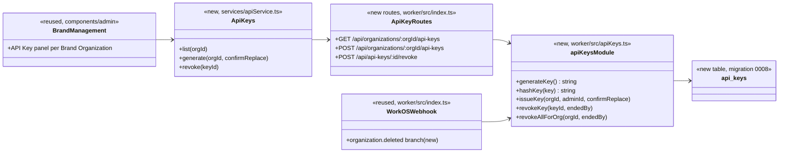
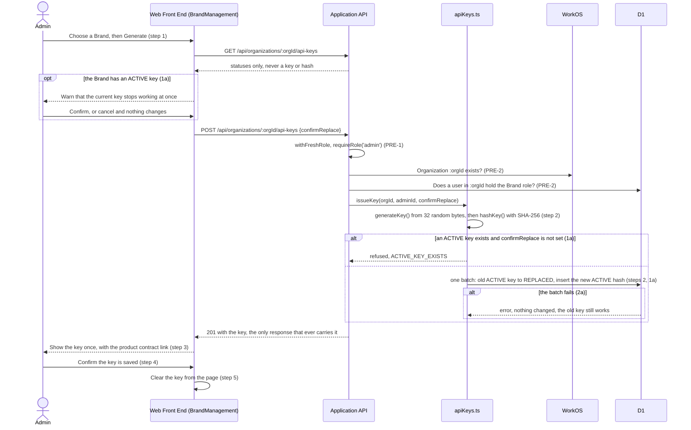
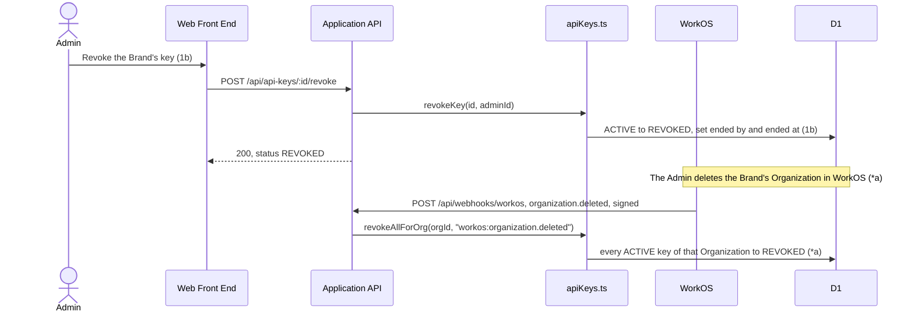

# Brand Participation Design

**Project:** Market Match
**Team:** Team 11
**Area:** `UC-BRND`

> **Realizes:** `UC-BRND-generate-api-key`
> **Depends on:** `BR-admin-issues-api-key`, `BR-connect-product-system`, `BR-create-organization`, `BR-admin-role`; `SEC-authentication`, `SEC-api-key-strength`, `SEC-api-key-ending`; `KD-api-key-storage`
> **See:** [use cases](../requirements/use-cases.md#brnd-brand-participation), [specification](../requirements/software-requirements-specification.md), [architecture-of-record](architectural-design.md)
> **Designed against:** `MM-Version`, branch `tcu-fall-2026-stage`, commit `699a0ac`

---

_**How to use this template.** Copy it to `docs/design/<area>.md`, named for the lowercase area code (`ord.md` for `UC-ORD-*`). Instructions appear in italic square brackets; leave them in place until the document is stable, because the agent reads them on every later pass. The full worked example is Project Pulse's [`not.md`](https://github.com/Washingtonwei/project-pulse/blob/main/docs/design/not.md); read it for the shape, not for the answers._

_**What this document is.** The **design-of-record** for one use case area: how the code will realize its use cases, written **before** the code and approved before anyone builds from it. It is the last document your agent reads before it writes code, so anything it leaves out, the agent invents. Your [architecture-of-record](architectural-design.md) is the map of the whole system and stops at each component's responsibility; this document goes one level down, inside one area, against real code._

_**What it is not.** A copy of your use cases. It **cites** `UC-*`, `FR-*`, and `BR-*` by identifier and never restates what the system shall do; it says only how. It is also not a transcript of the code. Once code exists, link to the files rather than describing every class, column, or getter._

_**One document per area, not per use case.** Your area gains use cases over the term. The overview, the class diagram, and the data model are **revised in place** when it does. The sequence diagrams, the API contract rows, and the test rows are **appended**, one set per use case. Never add a `## UC-…` section that repeats the whole skeleton._

_**How much to write.** Pin down what a wrong guess would break: a requirement, a business rule, a quality attribute, or the contract between two parts of your team. Leave the rest for the agent to derive while it builds: variable names, field types, exact JSON, column lengths. When you are unsure, ask which side of that line a detail falls on, not whether it is interesting._

_**Write it in this order.** Each step is one person's or one pair's work, and the order is the point:_

1. _**Sketch it yourselves first.** Before you open the agent, draw the main success scenario's sequence diagram and write the API contract rows by hand, from the use case and your architecture-of-record. Twenty minutes, on paper or in this file._
2. _**Have the agent draft it.** Give the agent this template, the use case, the business rules it cites, your architecture-of-record's section 8 (Crosscutting Concepts), and the relevant existing code, and ask for a draft of this document. Use plan mode, so it proposes before it writes._
3. _**Compare the two.** Where the agent's draft differs from your sketch, decide which is right and why. What it found that you missed goes in; what you knew that it could not have known is the context your specification is missing, so fix the specification too._
4. _**Run the questions test** (the last section) and fix what it finds._
5. _**Open a pull request.** A teammate who did not write it reviews and approves it. Nobody starts an implementation branch from this design until it is merged._

---

## Overview

_[One paragraph: what this area does, which components of your [architecture-of-record](architectural-design.md) it lives in, and what it reads from or calls in other areas. Link the container diagram rather than redrawing it. If this design changes the architecture-of-record, say so here and list the change under "Changes to the architecture-of-record" below.]_

The BRND area brings a Brand's products into Market Match and lets the Admin control who may send them. So far this document realizes one use case, `UC-BRND-generate-api-key`: the Admin issues, replaces, and revokes the API Key a Brand's own system will use to send products (`UC-BRND-send-products`, designed later). It lives in the Application API and the Web Front End ([containers](architectural-design.md#51-containers)), in the Identity component, which issues and ends API Keys, with the Admin's screens in the Brands tab of the Admin dashboard ([components](architectural-design.md#52-use-case-areas-and-components)). It reads Organizations from WorkOS and users from D1, and reuses the existing WorkOS webhook to end a deleted Brand's key. It adds one D1 table. It fills section 8.2.2 of the architecture-of-record and adds one risk to section 11 (see the last section).

## Components & classes

_[One class diagram for the whole area, and one line per class or file saying what it does and whether it is **new** or **reused**. Show only what a reader needs to see how the parts relate: classes, their key methods, their dependencies. Fields and getters belong to the code._

_**If your repository has no code for this area yet**, which is the normal case for your proving slice, list the files you expect the agent to create, with the paths your architecture-of-record's conventions give them, and mark them all new. The agent then builds into the structure you chose rather than one it improvised.]_

- `worker/migrations/0008_api_keys.sql` (new): creates `api_keys` and its indexes (Data model below).
- `worker/src/schema.ts` (reused): adds the `apiKeys` table definition for Drizzle.
- `worker/src/apiKeys.ts` (new): the only code that creates, hashes, or ends an API Key. A module of its own, not more of `index.ts`, because `UC-BRND-send-products` will call `hashKey` to check a key on every sending.
- `worker/src/index.ts` (reused): the three routes, each behind the existing `withFreshRole` and `requireRole('admin')`, and a new `organization.deleted` branch in the existing `POST /api/webhooks/workos` handler.
- `services/apiService.ts` (reused): a new `ApiKeys` group using the existing `request` helper (§8.2.1, §8.2.3).
- `components/admin/BrandManagement.tsx` (reused): already receives `workosOrgs` in the Admin's Brands tab. Gains an API Key panel for each Organization in `workosOrgs`: the newest key's status and who generated or ended it and when, Generate (or Replace, with the warning of extension 1a), Revoke, and a dialog that shows a new key once. The panel is not filtered to Brands in the browser; the server's `422 NOT_A_BRAND` is the check that counts (§8.2.5). Older keys and showing a name rather than a user id are left to the build; no requirement depends on either.

## Sequence

_[One sequence diagram per use case for its main success scenario, plus one for each extension that does not just return an error. **Label each interaction with the use case step it implements**, so a reviewer can check that every step is realized and nothing extra was invented. Use `alt` blocks for extensions that branch off the main flow. Give each use case its own `###` heading; that heading is the anchor your traceability matrix cites.]_

### UC-BRND-generate-api-key: generating, replacing, and revoking an API Key

Extensions 4a and 5a need no flow of their own: no endpoint returns a key after the `201`, so a key not saved (4a) or leaked (5a) is replaced by generating a new one, which is extension 1a.

The generation is recorded at step 2, when the row is written, not at step 5: extension 4a treats a key the Admin never confirmed as live until a new one replaces it, so the record must exist from the moment the key does. Step 4's confirmation only clears the page; nothing is sent to the server.

Step 3's link to the published product contract waits for `UC-BRND-send-products`, whose design publishes that contract. Until then the dialog shows the key without the link; this design covers step 3 only in part, and the link has a deferred test below.

Revoking (1b) and the webhook (\*a) change only `api_keys`; no product, Inventory, or Approval row is touched, so products already received keep their Approval status (1b).

## API contract

_[One row per endpoint, scheduled job, or message this area adds or changes, appended per use case. **This section is never dropped**: before the code exists it is the only thing the person (or agent session) building the front end and the one building the back end both read. Name the caller and who may call it, the request fields, the success response, and the error each extension returns. Leave field types and exact JSON to the agent unless a wrong guess would break something, such as a format another system depends on. Use the error shape your architecture-of-record's section 8.2 fixes; do not invent one here.]_

Errors use the existing shape: a status code and `{ "error": "<message>" }`, which `services/apiService.ts` turns into a thrown error (§8.2.1). Where a code is named below, it is the `error` message, so the Admin's screen can tell the cases apart.

| Endpoint or job | Caller (who may) | Request | Success | Errors, by extension |
|---|---|---|---|---|
| `GET /api/organizations/:orgId/api-keys` | The Admin (`withFreshRole`, `requireRole('admin')`) | None | `200`: each key's id, status, generated by and at, ended by and at. **Never the key, never its hash.** | Not signed in: `401`. Not the Admin: `403`. |
| `POST /api/organizations/:orgId/api-keys` | The Admin, as above | `confirmReplace` (boolean, optional; true with no `ACTIVE` key generates as normal) | `201`: the new key's id, the key itself, generated at. The only response that ever carries a key (steps 2–3). | 1a, an `ACTIVE` key exists and `confirmReplace` is not true: `409 ACTIVE_KEY_EXISTS`. PRE-2, no such Organization in WorkOS: `404 ORGANIZATION_NOT_FOUND`; no user in it holds the Brand role: `422 NOT_A_BRAND`. 2a, saving fails: `500`, and any existing key stays `ACTIVE`. WorkOS unreachable: `502`, nothing stored. `401`, `403` as above. |
| `POST /api/api-keys/:id/revoke` | The Admin, as above | None | `200`: the key's id and status `REVOKED` (1b) | No such key: `404`. Already `REPLACED` or `REVOKED`: `409 KEY_ALREADY_ENDED`. `401`, `403` as above. |
| `POST /api/webhooks/workos`, event `organization.deleted` (existing endpoint, new branch) | WorkOS, verified by the existing signature check | WorkOS's event, `data.id` is the Organization | Every `ACTIVE` key of that Organization becomes `REVOKED`, ended by `workos:organization.deleted` (\*a). Returns `200`. | Revoking fails: `500`, so WorkOS retries (Key decisions). Bad or missing signature: `401`, as today. |

## Key decisions

_[Only the decisions a reader could not recover from the code: an invariant, who may do this and how it is enforced, a trade-off you chose, a reason you reused something rather than writing it. **Each one names what you chose, what you rejected, and why.** If you cannot name an alternative you considered, it probably was not a decision; leave it out._

_A decision that affects the whole system rather than this area is an architecture decision. It belongs in your architecture-of-record as a `KD-*` entry, not here.]_

**One active key per Brand, enforced by D1.** A partial unique index allows one `ACTIVE` row per `workos_org_id`, and replacing a key ends the old row and inserts the new one in one D1 batch, so either both happen or neither does. Rejected: checking for an active key in code and then inserting, because two requests at once could both pass the check, and a failure between the two writes could leave a Brand with two working keys or none (extension 2a).

**A key belongs to the Brand's WorkOS Organization.** The `workos_org_id` is the same identifier products carry in `org_id`. Rejected: tying a key to the Admin who generated it or to a Brand user, because the key would then stop working when that person leaves, which the use case rules out (extension \*a).

**What counts as a Brand.** An Organization is a Brand when it exists in WorkOS and at least one D1 user with that `workos_org_id` holds the Brand role, in `role` or in `roles` (PRE-2). WorkOS Organizations carry no type, and Vendors have Organizations too. Rejected: accepting any Organization, which would give a Vendor a key for sending products (`BR-products-brand-only`); and asking the client how he marks Organizations, which would block this slice for data we already have. Decided by Matthew Stafford, 2026-10-28.

**A deleted Organization's keys are revoked by the WorkOS webhook.** The existing, signed `POST /api/webhooks/workos` gains an `organization.deleted` branch that revokes every active key of that Organization. Rejected: asking WorkOS on every sending whether the Organization still exists, which puts an external call on every request (`KD-api-key-storage`); and relying on the Admin to revoke the key by hand before deleting an Organization, which he can forget. Market Match has no route that deletes an Organization (only `GET /api/organizations` at `699a0ac`); the Admin deletes one in the WorkOS dashboard, so the webhook is the only path. A delete route added later revokes the keys itself before it returns.

**The `organization.deleted` branch returns `500` when revoking fails.** The handler's `catch` returns `200` on every error today, so WorkOS does not retry; this branch alone returns `500`, so WorkOS retries until the keys are revoked. Revoking again changes nothing, so a retry is safe. The other branches keep returning `200` on error. Rejected: the existing `200`, which would leave a deleted Brand's key working with no retry (`SEC-api-key-ending`).

**A key ends once, in one conditional write.** Revoking, replacing, and the webhook end a key with an update that matches only while it is still `ACTIVE` (`WHERE id = ? AND status = 'ACTIVE'`, or by `workos_org_id` and `status = 'ACTIVE'`). When a revoke changes no row, it returns `409 KEY_ALREADY_ENDED`. Rejected: reading the status and then updating, because a revoke and a replace arriving together could both end the same row, and the second would overwrite who ended it and when (§8.2.9).

**Replacing a key needs confirmation on the server.** `POST` refuses with `409 ACTIVE_KEY_EXISTS` unless `confirmReplace` is true, so the warning of extension 1a cannot be skipped by calling the API directly. Rejected: warning only in the browser.

**The key row is its own audit record.** Who generated a key and when are written once, at generation; who ended it and when, once, when it ends; neither is overwritten afterwards (§8.2.9). Rejected: a separate audit log table, which no other area needs yet.

**The key format.** 32 bytes from `crypto.getRandomValues`, 256 bits (`SEC-api-key-strength`), encoded as base64url without padding (43 characters), stored only as its SHA-256 hash in lowercase hexadecimal. The hash is taken over the UTF-8 bytes of the key string exactly as the `201` returns it, and only `hashKey` computes it, so `UC-BRND-send-products` hashes a received key the same way; if they differ, no key ever works. A plain hash is enough because a 256-bit random key cannot be guessed (`KD-api-key-storage`). Any readable prefix on the key is left to the build, and is part of the string hashed.

## Data model

_[The **change** this area makes to the data: new tables or entities, new columns, the migration that adds them. Draw an ER diagram when there is more than one new table. Do not redraw the domain model; your [specification](../requirements/software-requirements-specification.md) owns it, so link it and show only the change. If the area changes nothing, say "No change" and give the reason in one line; that is a design decision too.]_

One new table, `api_keys`, added by `worker/migrations/0008_api_keys.sql` and mirrored in `worker/src/schema.ts`:

| Column | Meaning | Constraint |
|---|---|---|
| `id` | The key's identifier, shown to the Admin | Primary key |
| `workos_org_id` | The Brand's Organization | Not null; indexed |
| `key_hash` | SHA-256 of the key, hexadecimal | Not null; unique |
| `status` | `ACTIVE`, `REPLACED`, or `REVOKED` | Not null |
| `created_by`, `created_at` | The Admin's D1 `users.id` (the session's `user.id`); when, UTC | Not null; written once; no foreign key |
| `ended_by`, `ended_at` | The Admin's D1 `users.id`, or `workos:organization.deleted`; when, UTC | Null until the key ends; written once; no foreign key |

`created_by` and `ended_by` carry no foreign key, unlike the schema's other user columns: `ended_by` can hold `workos:organization.deleted`, which is not a user, and the audit record must outlive the user, since `DELETE /api/users/:id` exists and D1 enforces foreign keys.

A partial unique index on `workos_org_id` where `status = 'ACTIVE'` keeps one active key per Brand: `CREATE UNIQUE INDEX … ON api_keys (workos_org_id) WHERE status = 'ACTIVE'`. Without the `WHERE`, every replace fails. `0008` is the next number (`worker/migrations/` holds `0001` to `0007` at `699a0ac`). Write its SQL by hand, as every existing migration is; never run `npm run db:generate`, because `drizzle.config.ts` still points at PostgreSQL and `server/`. Mirror the index in `schema.ts` with `.where(…)`.

Timestamps are UTC ISO 8601 text (§8.2.2). Both `created_at` and `ended_at` are set in code with `new Date().toISOString()`, with no column default, so the table holds one format: the schema's `datetime('now')` defaults write a different string (`YYYY-MM-DD HH:MM:SS`) that browsers may read as local time.

## Reuse & cross-cutting

_[Which existing services, components, and conventions this area uses rather than rebuilding: authentication, the error handler, email, the clock, another area's service. Cite your architecture-of-record's section 8.2 for each convention by name rather than restating it.]_

- **Authentication and authorization:** the existing `authMiddleware` session, re-read from D1 by `withFreshRole` so an Admin whose role was removed is refused at once, then `requireRole('admin')` (§8.1).
- **WorkOS:** the Organization lookup follows the existing `GET /api/organizations` route, which calls WorkOS's REST API with `WORKOS_API_KEY`; the webhook reuses the existing signature check (`verifyWorkOSSignature`).
- **Front end calls** go through `services/apiService.ts` (§8.2.1, §8.2.3).
- **Error handling** (§8.2.1), **time** (§8.2.2), **validation on the server** (§8.2.5), **logging**: never log a key or its hash, only the key's id and the Organization id; at `699a0ac` no middleware logs request or response bodies, so the `201` reaches no log (§8.2.7), **persistence**: migration `0008`, the D1 batch (§8.2.8), **auditing** (§8.2.9), **testing** by hand (§8.2.10).

## Tests

_[One row per flow: the main success scenario and **every** extension of every use case this document realizes, appended per use case. Name the level (unit or integration) and what the test asserts. No code. This list is the definition of done that the reviewer approves; the agent writes these tests when it builds, and a reviewer can see at a glance whether an extension has no test._

_There is no test framework yet, so each row is run by hand against `npm run dev` and its result recorded in the pull request (§8.2.10).]_

| Use case, flow | Level | Asserts |
|---|---|---|
| UC-BRND-generate-api-key main | integration | The Admin generates a key for a Brand with none: `201` carries a key of at least 256 bits; D1 holds one `ACTIVE` row whose `key_hash` is the SHA-256 of that key and no column holds the key; the panel shows the key once and clears it after confirmation |
| UC-BRND-generate-api-key 1a | integration | With an `ACTIVE` key, `POST` without `confirmReplace` returns `409 ACTIVE_KEY_EXISTS` and changes nothing; with it, the old row becomes `REPLACED` with ended by and at, and the new row is the only `ACTIVE` one |
| UC-BRND-generate-api-key 1b | integration | Revoking sets `REVOKED` with ended by and at, and leaves every product row unchanged; revoking it again returns `409 KEY_ALREADY_ENDED` and leaves ended by and at unchanged; an unknown id returns `404` |
| UC-BRND-generate-api-key 2a | integration | Forced on the tester's machine only, never committed and with no failure hook added to the code: change `generateKey` to return a fixed string, generate once, then replace, so the insert's duplicate `key_hash` fails the batch. The response is `500` and the old key is still the one `ACTIVE` row |
| UC-BRND-generate-api-key 4a and 5a | integration | No response other than the `201` contains a key or a `key_hash`, checked on `GET` after generating, replacing, and revoking |
| UC-BRND-generate-api-key \*a | integration | A signed `organization.deleted` event revokes every `ACTIVE` key of that Organization, ended by `workos:organization.deleted`; an unsigned one returns `401` and changes nothing |
| UC-BRND-generate-api-key \*a, revoking fails | integration | Forced on the tester's machine only, as in 2a (make `revokeAllForOrg` throw): a signed `organization.deleted` returns `500`; sent again after the change is undone, it revokes the keys and returns `200` |
| UC-BRND-generate-api-key \*a, later sendings refused | deferred | Needs `UC-BRND-send-products`; added to this list when it is designed |
| UC-BRND-generate-api-key step 3, product contract link | deferred | Needs the contract `UC-BRND-send-products` publishes; added to this list when it is designed |
| PRE-1, authorization | integration | Signed out: `401` on all three routes. A Brand or Vendor user: `403`. A user whose Admin role was removed in D1 after signing in: `403` |
| PRE-2 | integration | An Organization unknown to WorkOS: `404 ORGANIZATION_NOT_FOUND`. An Organization whose users hold no Brand role: `422 NOT_A_BRAND`. Nothing stored in either case |
| `SEC-api-key-ending` | integration | A replaced or revoked key's row is no longer `ACTIVE` immediately after the call returns |

## Changes to the architecture-of-record

_[Designing an area against real code is when the architecture's guesses meet reality. If this design needs a component the map does not have, moves a responsibility, or adds a dependency, **change [the architecture-of-record](architectural-design.md) in the same pull request** and list each change here in one line. If nothing changed, write "None". A design that silently disagrees with the architecture leaves two maps, and the agent will follow whichever it reads last.]_

- Section 8.2.2, time and time zones: filled with the rule this design uses (store UTC ISO 8601 text; show times in the viewer's time zone).
- Section 11: added `RISK-workos-org-deleted-event`, because extension \*a depends on the client's WorkOS dashboard sending `organization.deleted` to the webhook.

## Open questions & risks

_[What this design could not settle and who can, and what could go wrong that you are accepting. A question for the client also goes in [`OPEN-ISSUES.md`](../requirements/OPEN-ISSUES.md).]_

- **The webhook must receive `organization.deleted`.** If the client's WorkOS dashboard does not send that event to `/api/webhooks/workos`, a deleted Brand's key keeps working until the Admin revokes it (`RISK-workos-org-deleted-event`). The team checks the WorkOS webhook settings with the client before release.
- **Nothing uses a key yet.** A key can be generated and ended, but no sending exists until `UC-BRND-send-products`; that use case's design adds the key check, the product contract link of step 3, and the deferred tests above.
- **The Brand test reads D1.** If a Brand's users are not yet synced from WorkOS into D1, a real Brand is refused with `422 NOT_A_BRAND`; the Admin syncs users first, as the Admin dashboard already allows.

---

## Working this document with your agent

_[Delegate: drafting the diagrams from your sketch and the use case; listing the existing files a class should extend; filling the contract rows' request and response fields; proposing the test row for each extension; drafting the rejected alternative for a decision you have already made; checking that every identifier this document cites exists in the document that owns it._

_Keep human: which side of the "would a wrong guess break something" line each detail falls on; every key decision; and the approval, which is a teammate's review of the pull request, not the drafter's own reading._

_**The specific failure to watch for: scope that nobody asked for.** An agent drafting a design adds what designs it has read usually have: an admin override, a retry queue, a status field, a notification "while we are here". Each looks reasonable and none is in your use case, and once it is in the design the agent will build it, test it, and you will maintain it. Read the sequence labels: every interaction should name the use case step it implements. An interaction with no step is either a missing requirement, which goes to your specification and your client, or scope creep, which comes out.]_

---

## The questions test (before you open the pull request)

_[Start a **fresh** agent session in plan mode, so it carries nothing from the session that drafted this document. Give it only the use case, the business rules it cites, your architecture-of-record's section 8, and this document, and ask:_

> _List every point you would still have to guess to implement `<UC-ID>`. For each, say what you would guess and whether a wrong guess could violate a requirement. Do not write code._

_For each item on its list, either fix this document or keep the guess and write one line saying why a wrong guess breaks no requirement. Paste the list, with your answer to each item, into the pull request description under How it was verified, inside a collapsed `

Questions test
 … 
` block so the description stays short. The design is ready when nothing on the list could break a requirement.]_
